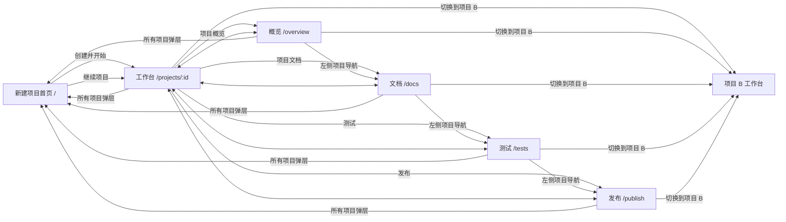

# MYATOM V7 桌面交互说明

> 2026-10-31 对话与阶段显隐修订。视觉沿用 V7；本文件与 [统一设计入口](design.md) 的新规则优先于下文早期“项目中心列表”和“右侧常驻”示意。V7 可点击原型与截图尚未按本轮修订更新，不能当作已实现证据。

## 0. 对话与产物的呈现门槛

| 服务端事实 | 默认主视图 | 右侧何时可见 |
| --- | --- | --- |
| 新项目、澄清中、等待澄清确认 | 用户需求与 Agent 澄清消息；待回答的结构化卡嵌在消息内 | 默认隐藏，不占工作区宽度 |
| 澄清已确认、计划生成或等待确认 | 已提交回答以用户消息/只读摘要保留；Agent 计划卡按时间接续 | 默认隐藏；计划形成后可由顶部“查看计划文档”手动打开文档 |
| 计划已确认、首次生成中 | 用户确认与 Agent 真实阶段消息接续；显示取消/重试等当前可用动作 | 默认隐藏；不得渲染空预览来填满空间 |
| 首个可用版本完成 | Agent 结果消息说明构建与检查结论、版本和下一步 | 预览/代码入口启用，可自动展开一次；之后尊重用户手动收起的选择 |
| 已有可用版本的新一轮运行 | 对话继续追加新需求、决策与进展 | 可保留旧版预览，明确标注版本及其与当前 run 的关系 |
| 构建失败待人工处理 | Agent 先给出基于构建记录的小结、最近错误和已尝试轮数；用户在当前卡下方明确发送修复方向或原样构建请求 | 有旧版可继续查看；详细日志在测试视图，Trace ID 可复制 |
| 其他失败或停止 | Agent 结果消息说明原因、已保留的版本和可执行动作 | 有旧版可继续查看；错误消息提供可复制的 Trace ID 供求助 |

正常用户对话只显示完成任务所需的事实、判断和下一步。内部事件序列、模型调用数、Token、工具日志、内部 run ID 与常驻“运行详情”卡不进入主时间线；运行中的真实阶段用单条可更新的轻量进展消息呈现，不形成多张等权卡片。澄清、回答、计划、确认、进度、结果按服务端时间/序号连续排列；当前待决卡在对应 Agent 消息中只采集结构化选择，当前卡片下方的“发送”是唯一对话提交入口。提交后保留原始消息、答案快照与解释结果，历史卡只读。原始诊断信息留在受控后台；异常消息可展示 Trace ID，并避免带出密钥或内部提示词。

右栏隐藏时，工作区只分配给当前对话，右栏分隔线和未就绪导航不占位。用户手动打开已形成的文档、直接访问文档 URL 或已有版本可预览时，按现有路由展示对应右侧视图；关闭后焦点回到打开入口，恢复对话草稿与滚动位置。预览需要真实可用版本，测试只显示已执行证据，发布只显示真实状态。阶段切换不能把“计划已形成”误当作“应用可预览”。

### 长任务进展与结束状态

澄清/计划期间只显示一条更新的 Agent 进展消息：本轮收集到的回答、当前判断和下一步。计划卡用未完成清单呈现计划任务，不能在确认前打勾。生成期间的第二份清单表示实际执行：源码写入、构建命令、静态预览资源、版本保存；按后端持久事件更新状态。执行时间来自服务端 Agent 累计工作秒数，等待用户和服务停机不累计，断线时冻结并显示重连提示。结果或待人工处理卡先出现，过程默认折叠，避免历史阶段继续抢占注意力。详细证据规则见 [ADR-012](../docs/decisions/ADR-012-user-facing-run-progress.md)。

## 1. 页面模型

本版共 **6 个主 URL 视图**：新建项目首页，以及项目内的工作台、概览、文档、测试和发布。首页无需当前项目，“所有项目”在首页以弹层呈现；其他五个视图由 URL 中的 `:id` 确定唯一项目。对话是项目内视图共用的持续区域，右侧内容由用户选择的视图与当前产物门槛共同决定。

`/projects/:id` 沿用当前项目 URL，避免无谓改变已存在的项目链接。五个项目内视图必须支持浏览器后退、前进和直接打开；非法或无权访问的 `:id` 显示访问错误并给出“返回首页”。

## 2. 全局项目切换

| 触发 | 预期行为 |
| --- | --- |
| 点击左上当前项目名 / 切换箭头 | 打开项目选择弹层；焦点进入搜索框；显示最近 5 个可访问项目、每项当前阶段和“所有项目”“新建项目”入口 |
| 输入项目名 | 在可访问项目中搜索；无匹配显示“没有找到项目”与“查看所有项目”，不伪造结果 |
| 选择项目 B | 弹层关闭；URL 变为 `/projects/B`；当前项目名、对话、右侧内容一同换成 B；B 默认进入工作台 |
| 点击“所有项目” | 打开可访问项目弹层；项目运行不会因打开弹层而取消 |
| 点击“新建项目” | 进入 `/` 并聚焦创建输入区；不先建空项目 |
| 浏览器后退 | 恢复历史 URL 对应的项目和页面；重新校验服务端状态；不提交草稿或重新启动 run |

切换项目时，先保存当前项目未提交的输入草稿，再显示目标项目的加载状态。项目 A 的消息、预览和状态不得挂在项目 B 的标题下。草稿按 `project_id` 与决策卡 `card_id/spec_version` 隔离；返回 A 时恢复并核对卡片版本。旧卡已失效时保留草稿以供比较，但不能直接确认。若切换时 A 正在构建，构建在服务端继续；回到 A 读取同一次运行，不重发创建或生成请求。

## 3. 首页与所有项目弹层：创建、查找、继续

- 中央需求输入是首页主动作。三个示例只填入可编辑草稿；空需求禁用提交，长度超限在输入旁报错。用户提交后才创建项目并发起本次需求，成功进入 `/projects/:id`。网络失败保留输入和幂等键，重试不产生重复项目或 run。
- 历史项目在左侧，完整项目列表由“所有项目”弹层承载，按最近活动排序并可搜索；选择项目统一进入其工作台，不自动跳到上次看的状态页。列表只显示有访问权限的项目。
- 空列表显示“还没有项目”，首页焦点仍可回到创建输入；无搜索结果提示清空搜索。加载失败显示重试，不把故障误判为空项目。

## 4. 同一项目内的五页

| 页面 | 中间对话 | 右侧主内容 | 主交互 |
| --- | --- | --- | --- |
| 工作台 | 按时序呈现需求、澄清、用户决定、计划、确认、进展、结果和输入 | 有可用版本时可打开预览/代码；无版本默认隐藏，不占空间 | 回答澄清、确认计划、继续提需求；有版本时切换和操作预览 |
| 项目概览 | 保持 | 目标、当前阶段、下一步、最近成功版本、最近活动 | 从“下一步”返回工作台并定位当前决策卡；从版本进入工作台对应版本 |
| 项目文档 | 保持 | 已确认需求、计划、决定、生成文件入口 | 在文档小节切换、查看版本与来源；修改需求从工作台发起新 run，不直接改已确认旧文档 |
| 测试 | 保持 | 每项实际执行状态、耗时、证据/日志、关联版本 | 展开单项证据；失败时按服务端允许动作返回工作台处理或重试 |
| 发布 | 保持 | 发布准备条件、当前发布状态、真实链接/阻塞项 | 在能力可用且条件满足时发起发布；未就绪只显示原因和可去的页面 |

右侧导航只在右栏打开后出现。用户从对话入口或右侧导航切页时，URL 与高亮同步变化，**只替换右侧内容**。中间对话组件保持挂载；输入内容、滚动位置与当前决策卡选择不丢失。右侧每页独立记住本项目内的局部阅读位置。返回工作台时恢复同一项目先前选中的版本和“预览/代码”页签。若目标版本失效，改为最新可用版本并写明原因。

澄清、计划和构建确认仍在对话时间线中完成。状态页可以显示摘要和“去工作台处理”链接，但不能在概览、文档、测试、发布四处复制同一确认按钮。当前任务只有一个权威操作位置。

澄清、计划和构建失败等待态的当前卡与唯一输入区同处一条 Agent 对话，输入区紧接卡片；其他阶段保留独立的新需求草稿输入区。澄清卡出现时，输入区默认仍为空白消息；选齐必答项可空文字发送，补充需求修改优先且重新澄清。只有用户主动点“修改原需求”，才切换为全文编辑，并可取消回到原草稿。计划消息可以是修改、提问或明确批准；含糊确认不启动生成。构建失败等待人工时，当前卡下方发送一次修复、指定方向或原样重建请求。卡片只承载结构化问题、证据、选择与按需展开的详情。输入区只显示 `n/上限` 字数；Enter 发送，Shift+Enter 换行，中文输入法组合输入期间不发送。构建中允许写下一轮草稿，发送动作暂不可用；未发送内容按项目及卡片版本隔离，并在同一浏览器会话刷新后恢复。详见 [ADR-010](../docs/decisions/ADR-010-structured-card-single-send.md)。

## 5. 跳转细节与条件动作

| 起点与动作 | 目标/反馈 | 条件 |
| --- | --- | --- |
| 概览 → “继续当前任务” | 工作台，滚动定位最新待确认卡或最近进度 | 使用真实 run 阶段决定定位对象 |
| 概览/文档/测试 → 点击版本 vN | 工作台，选中 vN 的预览/代码 | 有该版本访问权限；旧版本标“历史版本” |
| 文档 → 点击生成文件 | 工作台右侧“代码”并打开该文件；或在文档页右侧详情层查看 | 文件真实存在且可读取 |
| 测试 → “查看日志” | 右侧详情抽屉/展开区，不改变项目与主导航 | 日志真实可读；脱敏展示 |
| 测试 → “处理失败” | 工作台，定位失败结果卡 | 当前失败 run 存在；保留上一个成功版本 |
| 发布 → “查看未通过测试” | 测试页，定位阻塞项 | 有对应测试记录 |
| 发布 → “发布” | 显示发布确认和进度；成功后写入真实 URL | 后端提供发布能力、权限与就绪条件；重复点击幂等 |
| 发布 → “打开应用” | 新窗口打开真实 URL | 有已验证的公开链接；否则不显示此动作 |

“发布”是项目生命周期入口，不等于当前 MVP1 已有发布能力。未部署时显示“尚未发布”与具体条件；不能渲染可点击的假链接或用预览 URL 代替公开 URL。预览同理：没有有效 `preview_ref` 时，不显示可操作的模拟应用。

## 6. 各类状态

| 状态 | 项目中心 | 项目内右侧 | 对话 |
| --- | --- | --- | --- |
| 加载 | 列表骨架仅覆盖行位置 | 目标页面骨架，保留页名 | 切换项目时显示目标项目加载态；同项目切页不清空对话 |
| 空 | 创建输入为主，说明尚无项目 | 无可用版本时工作台右栏默认隐藏；用户主动打开的文档/测试页如无内容，简要说明尚未形成或执行 | 没有 run 时给“描述要做的应用”输入 |
| 失败 | 保留创建草稿和已载列表，提供重试 | 说明哪项读取失败；旧成功版本保持可找 | 失败 run 的原因、可执行动作按服务端状态显示 |
| 离线 | 列表读取失败可重试 | 标“状态可能不是最新”，避免显示新通过/已发布 | 保留未提交输入；重连后读取同一 run |
| 无权限/不存在 | 不列出项目 | 项目内统一错误态，提供“返回所有项目” | 不泄露该项目历史消息 |

项目列表/切换器的状态文案使用同一服务端事实：`等待需求确认`、`等待计划确认`、`正在生成`、`等待你决定如何处理`、`代码已保存`、`需要处理`等。项目列表只显示最近成功版本与当前运行状态，不把“代码已保存”等同于“可预览”或“已发布”。

## 7. 键盘、焦点与尺寸

- `Tab` 顺序：当前项目选择器 → 左侧导航 → 中间对话与输入 → 已打开的右侧内容。隐藏的右栏及其分隔线不进入焦点顺序。项目切换弹层打开后聚焦搜索，`Esc` 关闭并回到触发按钮；方向键可在列表项中移动，`Enter` 选择。
- 同项目切页后，焦点到右侧页面标题；浏览器后退时回到触发导航。对话区域不自动滚到底，用户在读历史时新事件只出现“有新进展”提示。
- 设计目标为桌面 1280×720、1366×768、1440×900。左导航约 200px；无可用版本且未主动打开右栏时，对话占满剩余工作区；预览可用并打开时对话约 400–440px，预览占其余。小于 1280px 不承诺手机专用布局。
- 左侧分隔线始终可按条件拖动；右侧分隔线仅在右栏打开时出现和可聚焦。导航栏 180–300px、双区时对话区至少 360px、右侧至少 620px。左右方向键每次调整 16px，按住 Shift 调整 48px，Home/End 到边界，Esc 取消当前拖动。双击分隔线或点击“恢复默认布局”可重置。偏好在本机浏览器跨项目、跨页面保存；视口缩小时只夹紧显示宽度，不覆盖保存值，重新放大后恢复。低于 1280px 时沿用已有窄屏布局，禁用拖动。
- 普通文本对比至少 4.5:1，焦点 2–3px 可见描边；状态不只用颜色，屏幕阅读器收到简短阶段更新。减少动态效果偏好下禁用循环动效。

## 8. 设计验收路径

1. 在项目中心创建 A；进入 A 工作台，回答澄清；返回项目中心，再建 B。
2. 在 B 工作台打开切换器，选择 A：URL、标题、对话、右侧结果均属于 A，B 的未提交输入不混入。
3. 在 A 的概览、文档、测试、发布之间切换：对话和草稿不变，只有右侧换页；浏览器后退恢复上一个项目内页面。
4. A 构建中切到 B，再回 A：A 是同一个 run 的新状态，没有第二次生成。
5. 无可用版本的项目：右侧默认不占位；对话能手动打开已形成的计划文档。首个版本完成后预览入口可用，打开后必须是真实预览。未测试或未发布时不显示虚构通过或公开链接。
6. 正常运行时：对话中能按序读到澄清、回答、计划、确认、真实进展和结果；主界面无“过程记录”列表、模型调用数、Token 或常驻运行详情。失败消息显示原因、下一步及可复制 Trace ID；刷新后已完成的对话决定仍可读。

这些是设计验收标准；本次修订仅更新设计说明，尚未据此确认正式产品前端通过上述用例。
