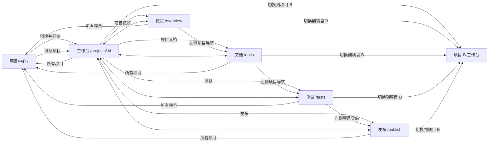

# 多项目导航与交互说明

## 1. 页面模型

本版共 **6 个主页面**：一个跨项目的项目中心，加一个项目内工作台与四个项目状态页。项目中心无需当前项目；其他五页都以 URL 中的 `:id` 确定唯一项目。对话是五个项目内页面共用的持续区域，右侧区域由路由决定。

`/projects/:id` 沿用当前项目 URL，避免无谓改变已存在的项目链接。五个项目内页面必须支持浏览器后退、前进和直接打开；非法或无权访问的 `:id` 显示访问错误并给出“返回所有项目”。

## 2. 全局项目切换

| 触发 | 预期行为 |
| --- | --- |
| 点击左上当前项目名 / 切换箭头 | 打开项目选择弹层；焦点进入搜索框；显示最近 5 个可访问项目、每项当前阶段和“所有项目”“新建项目”入口 |
| 输入项目名 | 在可访问项目中搜索；无匹配显示“没有找到项目”与“查看所有项目”，不伪造结果 |
| 选择项目 B | 弹层关闭；URL 变为 `/projects/B`；当前项目名、对话、右侧内容一同换成 B；B 默认进入工作台 |
| 点击“所有项目” | 进入 `/`，显示完整项目列表及创建入口；项目运行不会因离开页面而取消 |
| 点击“新建项目” | 进入 `/` 并聚焦创建输入区；不先建空项目 |
| 浏览器后退 | 恢复历史 URL 对应的项目和页面；重新校验服务端状态；不提交草稿或重新启动 run |

切换项目时，先保存当前项目未提交的输入草稿，再显示目标项目的加载状态。项目 A 的消息、预览和状态不得挂在项目 B 的标题下。草稿按 `project_id` 与决策卡 `card_id/spec_version` 隔离；返回 A 时恢复并核对卡片版本。旧卡已失效时保留草稿以供比较，但不能直接确认。若切换时 A 正在构建，构建在服务端继续；回到 A 读取同一次运行，不重发创建或生成请求。

## 3. 项目中心：创建、查找、继续

- 顶部输入区是首屏主动作：写需求，可选项目名，点击“创建并开始”。示例需求只填入输入框；空需求禁用提交，长度超限在输入旁报错。提交后先创建项目，再发起该项目的本次需求；成功进入 `/projects/:id`。网络失败保留输入和幂等键，重试不产生重复项目或 run。
- 输入区下是项目列表。默认按最近活动排序；每行依次显示项目名、当前阶段/下一步、最近成功版本（若有）、更新时间和“继续”。点击行或“继续”均进入该项目工作台；不自动跳到上次看的状态页。列表搜索只匹配有访问权限的项目。项目数增多时分页或继续加载，不能无限增高首页首屏。
- 空列表显示一句“还没有项目”，焦点仍回到创建输入；无搜索结果显示清空搜索。加载失败显示重试，不把故障误判为空项目。不可访问的项目不出现在列表。

## 4. 同一项目内的五页

| 页面 | 中间对话 | 右侧主内容 | 主交互 |
| --- | --- | --- | --- |
| 工作台 | 当前 run 时间线、决策卡、进展、输入 | 真实可用时显示预览/代码与版本；否则显示版本和结果状态 | 回答澄清、确认计划、继续提需求、切换版本、操作预览 |
| 项目概览 | 保持 | 目标、当前阶段、下一步、最近成功版本、最近活动 | 从“下一步”返回工作台并定位当前决策卡；从版本进入工作台对应版本 |
| 项目文档 | 保持 | 已确认需求、计划、决定、生成文件入口 | 在文档小节切换、查看版本与来源；修改需求从工作台发起新 run，不直接改已确认旧文档 |
| 测试 | 保持 | 每项实际执行状态、耗时、证据/日志、关联版本 | 展开单项证据；失败时按服务端允许动作返回工作台处理或重试 |
| 发布 | 保持 | 发布准备条件、当前发布状态、真实链接/阻塞项 | 在能力可用且条件满足时发起发布；未就绪只显示原因和可去的页面 |

左侧点击五个入口时 URL 与高亮同步变化，**只替换右侧内容**。中间对话组件保持挂载；输入内容、滚动位置与当前决策卡选择不丢失。右侧每页独立记住本项目内的局部阅读位置。返回工作台时恢复同一项目先前选中的版本和“预览/代码”页签。若目标版本失效，改为最新可用版本并写明原因。

澄清、计划和构建确认仍在对话时间线中完成。状态页可以显示摘要和“去工作台处理”链接，但不能在概览、文档、测试、发布四处复制同一确认按钮。当前任务只有一个权威操作位置。

## 5. 跳转细节与条件动作

| 起点与动作 | 目标/反馈 | 条件 |
| --- | --- | --- |
| 概览 → “继续当前任务” | 工作台，滚动定位最新待确认卡或最近进度 | 使用真实 run 阶段决定定位对象 |
| 概览/文档/测试 → 点击版本 vN | 工作台，选中 vN 的预览/代码 | 有该版本访问权限；旧版本标“历史版本” |
| 文档 → 点击生成文件 | 工作台右侧“代码”并打开该文件；或在文档页右侧详情层查看 | 文件真实存在且可读取 |
| 测试 → “查看日志” | 右侧详情抽屉/展开区，不改变项目与主导航 | 日志真实可读；脱敏展示 |
| 测试 → “处理失败” | 工作台，定位失败结果卡 | 当前失败 run 存在；保留上一个成功版本 |
| 发布 → “查看未通过测试” | 测试页，定位阻塞项 | 有对应测试记录 |
| 发布 → “发布” | 显示发布确认和进度；成功后写入真实 URL | 后端提供发布能力、权限与就绪条件；重复点击幂等 |
| 发布 → “打开应用” | 新窗口打开真实 URL | 有已验证的公开链接；否则不显示此动作 |

“发布”是项目生命周期入口，不等于当前 MVP1 已有发布能力。未部署时显示“尚未发布”与具体条件；不能渲染可点击的假链接或用预览 URL 代替公开 URL。预览同理：没有有效 `preview_ref` 时，不显示可操作的模拟应用。

## 6. 各类状态

| 状态 | 项目中心 | 项目内右侧 | 对话 |
| --- | --- | --- | --- |
| 加载 | 列表骨架仅覆盖行位置 | 目标页面骨架，保留页名 | 切换项目时显示目标项目加载态；同项目切页不清空对话 |
| 空 | 创建输入为主，说明尚无项目 | 文档/测试/版本分别说明还没有产生什么以及何时出现 | 没有 run 时给“描述要做的应用”输入 |
| 失败 | 保留创建草稿和已载列表，提供重试 | 说明哪项读取失败；旧成功版本保持可找 | 失败 run 的原因、可执行动作按服务端状态显示 |
| 离线 | 列表读取失败可重试 | 标“状态可能不是最新”，避免显示新通过/已发布 | 保留未提交输入；重连后读取同一 run |
| 无权限/不存在 | 不列出项目 | 项目内统一错误态，提供“返回所有项目” | 不泄露该项目历史消息 |

项目列表/切换器的状态文案使用同一服务端事实：`等待需求确认`、`等待计划确认`、`正在生成`、`代码已保存`、`需要处理`等。项目列表只显示最近成功版本与当前运行状态，不把“代码已保存”等同于“可预览”或“已发布”。

## 7. 键盘、焦点与尺寸

- `Tab` 顺序：当前项目选择器 → 左侧导航 → 中间对话与输入 → 右侧内容。项目切换弹层打开后聚焦搜索，`Esc` 关闭并回到触发按钮；方向键可在列表项中移动，`Enter` 选择。
- 同项目切页后，焦点到右侧页面标题；浏览器后退时回到触发导航。对话区域不自动滚到底，用户在读历史时新事件只出现“有新进展”提示。
- 设计目标为桌面 1280×720、1366×768、1440×900。左导航约 200px；预览可用时对话约 400–440px，预览占其余；MVP1 待确认且无预览时允许对话更宽。小于 1280px 不承诺手机专用布局。
- 项目内两条分隔线可拖动：导航栏 180–300px、对话区至少 360px、右侧至少 620px。分隔线可聚焦；左右方向键每次调整 16px，按住 Shift 调整 48px，Home/End 到边界，Esc 取消当前拖动。双击分隔线或点击“恢复默认布局”可重置。偏好在本机浏览器跨项目、跨页面保存；视口缩小时只夹紧显示宽度，不覆盖保存值，重新放大后恢复。低于 1280px 时沿用已有窄屏布局，禁用拖动。
- 普通文本对比至少 4.5:1，焦点 2–3px 可见描边；状态不只用颜色，屏幕阅读器收到简短阶段更新。减少动态效果偏好下禁用循环动效。

## 8. 设计验收路径

1. 在项目中心创建 A；进入 A 工作台，回答澄清；返回项目中心，再建 B。
2. 在 B 工作台打开切换器，选择 A：URL、标题、对话、右侧结果均属于 A，B 的未提交输入不混入。
3. 在 A 的概览、文档、测试、发布之间切换：对话和草稿不变，只有右侧换页；浏览器后退恢复上一个项目内页面。
4. A 构建中切到 B，再回 A：A 是同一个 run 的新状态，没有第二次生成。
5. 未生成预览或未发布的项目：右侧清楚写明未就绪，不显示虚构预览、测试通过或公开链接。

这些是设计验收标准；本次交付为说明和示意图，尚未对产品前端执行上述用例。
