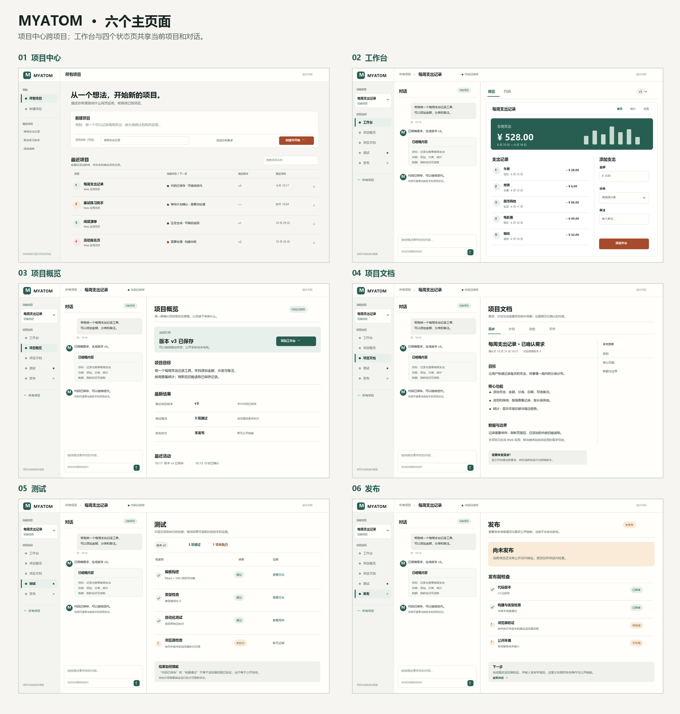

# MYATOM 多项目界面设计

> **当前设计入口：** [design.md](design.md)（已确认的 V7 原型与本轮反馈）；本页是早期多项目结构记录。

> **历史视觉版：** [V3 VI、图标、动效与精修页面](v3/README.md)。本页保留 V2 结构示意和六页交互基线；[当时的设计决策](DECISIONS-v3.md)说明 V3 的修改依据。

版本：2026-10-31 多项目版。沿用已确认的暖中性色“编辑台”视觉与 **AI 对话 + 预览** 主工作台。此目录是设计交付，不表示图中示例版本、测试和预览已经在产品中实现。

视觉基准：[整体风格图](style-direction-v2.png) · [三区结构图](workbench-structure-v2.png)。这两张图和下方所有页面图均已放在 `/design/`，便于独立查看。风格图的[生成提示词](style-direction-v2-prompt.md)一并保留。

## 页面数量：6 个主页面

| 编号 | 页面 | 路径 | 页面职责 | 示意图 |
| --- | --- | --- | --- | --- |
| 01 | 项目中心 | `/` | 创建项目、搜索和继续已有项目 | [01-projects.png](pages/01-projects.png) |
| 02 | 工作台 | `/projects/:id` | 当前项目的 AI 对话、确认卡、预览/结果 | [02-workbench.png](pages/02-workbench.png) |
| 03 | 项目概览 | `/projects/:id/overview` | 当前阶段、目标、最近版本与下一步 | [03-overview.png](pages/03-overview.png) |
| 04 | 项目文档 | `/projects/:id/docs` | 需求、计划、决定与生成文件 | [04-docs.png](pages/04-docs.png) |
| 05 | 测试 | `/projects/:id/tests` | 真实执行结果与证据 | [05-tests.png](pages/05-tests.png) |
| 06 | 发布 | `/projects/:id/publish` | 发布条件、状态与实际链接 | [06-publish.png](pages/06-publish.png) |

[切换项目弹层示意](pages/07-project-switcher.png)是工作台上的交互状态，**不是第 7 个主页面**。新建项目使用项目中心的输入区，文档小节、测试详情和版本选择都在现有页面内完成，不另设一级页面。

## 多项目的核心规则

1. 项目中心是跨项目入口；项目工作台及四个状态页只显示**当前项目**的数据。
2. 任一项目页左上有当前项目选择器。打开后可找最近项目、搜索、进入“所有项目”或新建项目。选择另一个项目总是进入该项目的**工作台**，顶部项目名、对话、预览、状态与 URL 同步换成新项目。
3. 在同一项目内点击左侧“概览、文档、测试、发布”只替换右侧内容；对话保持可见，输入草稿和阅读位置保留。点击“工作台”恢复该项目的预览/代码选择。
4. 项目切换期间清空旧项目可见内容并显示目标项目的加载态，防止项目 A 的信息短暂出现在项目 B 标题下。构建任务在服务端继续，回来时读取真实状态。
5. 多项目不会在主工作台把所有项目或四类状态平铺成等权卡片。完整项目列表只在项目中心，切换器只放最近若干项和搜索入口。

具体路径、事件、状态和异常见 [INTERACTIONS.md](INTERACTIONS.md)；颜色、字阶与组件规则见 [TOKENS.md](TOKENS.md) 和 [tokens.json](tokens.json)。

## 图示边界

示意图采用虚构的“每周支出记录”等项目作为样例。图中的 v3、支出明细、测试结论只是版式样例；实际界面必须以服务端项目、运行、版本、测试和预览状态渲染。MVP1 尚无交互预览、生成应用业务数据持久化和公开发布时，应显示明确的未就绪状态，不能显示图中的模拟成果。

本版只设计 MYATOM 建造工作台的桌面浏览器界面。生成应用自己的手机适配按项目需求单独决定。

示意图由 [render_pages.py](render_pages.py) 根据固定样例绘制，可重新生成，不修改产品代码。
