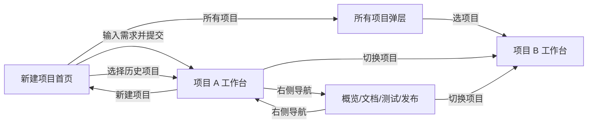

# MYATOM 桌面界面设计 · 统一入口

> 版本：V7（2026-10-31） · 状态：**用户已确认，作为当前设计原型**。此处汇总本轮设计讨论；独立原型仅使用浏览器内模拟状态，尚未同步正式产品。

## 从这里看

- [打开 V7 原型](http://127.0.0.1:8765/prototype-v7/#/) · [原型说明与评审截图](prototype-v7/README.md)
- [设计 Harness：反馈、决策、验收检查](harness.md)
- [统一设计 Token](token.json)
- [品牌 VI 与图标](v3/VI.md) · [动效原则](v3/MOTION.md)
- [PRD](../docs/PRD.md) · [架构](../docs/ARCHITECTURE.md) · [变更守则](../docs/decisions/ADR-002-change-control.md)

`design.md` 是当前设计入口；`design/tokens.json`、`design/TOKENS.md`、`design/README.md`、`design/INTERACTIONS.md` 及 V2/V3 页面图是早期记录。设计参照以用户已确认的 V7 和本文件为准；正式产品需求仍以 PRD/架构为准，差异见下文。`token.json` 尚未自动驱动 V7 CSS。

## 设计定位

MYATOM 是**对话形式的 AI Agent 产品**。界面同时承载两件事：中间让用户与 Agent 连续完成澄清、计划、生成和迭代；右侧把同一项目的预览、文件与状态可视化。左侧用于历史项目。三栏是职责分配，不是等宽、等权的信息面板。

整体风格是暖白“制作台”：纸白主内容、深绿色导航与可用状态、陶土橙用于当前待决定事项。标题与正文形成层次，结构线轻，预览有清楚的独立应用边界。图标使用同一线性体系；MYATOM Agent 的身份标记固定为左上角同源 `brand-mark.svg`，历史和当前回复一致。装饰和特效只在解释状态变化时使用，避免卡片墙、发光粒子、假进度和无意义说明。

## 六个 URL 视图与附属状态

| 视图 | 路径 | 页面焦点 | 保持/替换 |
| --- | --- | --- | --- |
| 新建项目首页 | `#/` | 中央需求输入；下方恰好三个样例卡 | 左侧保留历史项目；“所有项目”为弹层 |
| 工作台 | `#/projects/:id` | 中间 Agent 对话与当前任务；右侧预览/代码 | 当前项目的核心工作视图 |
| 项目概览 | `#/projects/:id/overview` | 当前阶段、目标、下一步、最近版本 | 只替换右侧 |
| 项目文档 | `#/projects/:id/docs` | 需求、计划、决定、文件 | 只替换右侧 |
| 测试 | `#/projects/:id/tests` | 执行状态、证据与阻塞 | 只替换右侧 |
| 发布 | `#/projects/:id/publish` | 就绪条件、发布状态与真实链接 | 只替换右侧 |

“所有项目”弹层、项目切换弹层、预览/代码页签、文档分节、日志展开、澄清/计划/构建/结果卡、右栏收起/放大都是上述页面内的交互状态，不另算主页面。V2 文档中的“项目中心列表页”已由当前 V7 原型的简洁首页＋所有项目弹层取代。

## 主工作台结构

| 区域 | 内容与优先级 | 交互 |
| --- | --- | --- |
| 左侧历史项目 | MYATOM 标识、所有项目、新建项目、搜索与历史项目；只给项目名与必要阶段 | 选择项目切到该项目工作台；当前项清晰标示 |
| 中间对话 | 项目需求、Agent 问题、用户决定、Agent 计划与结果，当前待处理卡在时间线里；底部持续输入 | 查看历史/回到当前；回答澄清、修改/确认计划、继续迭代；过程记录折叠 |
| 右侧项目内容 | 顶部固定“工作台 / 项目概览 / 项目文档 / 测试 / 发布”，下方显示对应内容 | 同项目内只替换本区；工作台可在预览/代码间切换，右栏可收起或放大 |

默认左栏 220px；工作区中间约 56%、右侧约 44%，并按可用宽度夹紧。两条分隔线支持拖动与键盘调整，可恢复默认，布局偏好存本机。目标为桌面 1280×720、1366×768、1440×900；不设计 MYATOM 手机专用界面。完整数值见 [token.json](token.json)。

## 用户旅程与跳转规则

1. **新建**：用户输入需求；样例卡只填入可编辑草稿，提交才创建项目并进入该项目工作台。首页不以全量项目列表抢占主视觉。
2. **同项目切视图**：点击右栏顶部导航更新 URL 与右栏内容；中间对话保持挂载，输入草稿和阅读位置保留。右栏页面各自可以记住局部阅读位置。前进/后退与 URL 一致。
3. **跨项目切换**：左栏历史、当前项目选择器或“所有项目”弹层选择另一项目，统一进入目标项目的工作台；项目名、对话、右栏、阶段和 URL 同步。旧项目草稿按项目隔离；不得瞬间显示旧数据配新标题。
4. **对话流程**：用户需求 → Agent 澄清 → 用户决定 → Agent 计划 → 用户确认 → Agent 结果。技术过程默认折叠，当前决定或结果在时间线内只有一个权威主动作。用户查看历史时，新进度不强迫滚到底。
5. **结果与文件**：没有可用版本时，右侧显示已知目标、当前阶段与未就绪说明；有真实可用版本才显示可操作预览。预览与代码、文档与测试的内容按真实项目和版本关联。未测试、未发布要直接说明，不能用示例数据冒充事实。

## 首页、排版与动效

- 首页参考常见对话产品的聚焦方式：居中的 H1、单个大输入框和三个可选起点；历史项目留在左侧。删除 H1 上方无语义菱形与冗余引导句。
- H1 依次显示“今天想做什么？”“快速产出产品模型？”“一个绝妙的主意！”，逐字出现、停顿、逐字删除并循环。标题区域固定高度，避免布局跳动；减少动态效果时静态显示第一句，屏幕阅读器获得稳定的标题。
- 全局字体按 [V7 Token](token.json) 放大：正文 18px，对话 17px、标签 16px，辅助信息最低 14px，主页 H1 50px。正文用系统中文无衬线；首页大标题可用宋体；文件名与日志用等宽字体。
- 动效用于弹层、右侧内容切换和操作反馈；不制造虚构进度。减少动态效果时即时切换，所有状态仍通过文字与图标表达。

## 评审图片

| 画面 | 图 |
| --- | --- |
| 简洁新建页 | [01-new-project.png](prototype-v7/screenshots/01-new-project.png) |
| 主工作台 | [02-workbench.png](prototype-v7/screenshots/02-workbench.png) |
| 1280×720 工作台 | [03-workbench-1280.png](prototype-v7/screenshots/03-workbench-1280.png) |
| 1280×720 澄清卡 | [04-clarify-1280.png](prototype-v7/screenshots/04-clarify-1280.png) |
| Agent 对话历史与统一头像 | [05-dialogue-history.png](prototype-v7/screenshots/05-dialogue-history.png) |

## 确认记录与实施边界

- **原型确认**：2026-10-31，用户确认“V7版本可用，作为当前的设计原型”。后续设计沿用 V7；此次确认不证明模拟后端能力或正式产品功能。
- **样例差异**：PRD 规定首页三例为“番茄钟待办、点老头游戏、移动点单”；V7 展示“每周支出记录、番茄钟待办、周末行程”。V7 的展示已作为原型内容接受；将其替换到正式产品涉及验收案例，仍需单独对齐 PRD。
- **主题差异**：PRD MVP4 仍要求默认与二次元主题；V7 只呈现默认主题，不代表取消第二主题。
- **能力边界**：原型中的项目、Agent 轮次、版本、预览、测试和发布均为模拟。正式产品必须用服务端事实与执行证据渲染，不从原型截图推断能力已实现。

后续原型修订按 [harness.md](harness.md) 的 DH-01～DH-09 逐项回归；正式产品实施另核对 PRD 差异、真实状态与功能测试。
