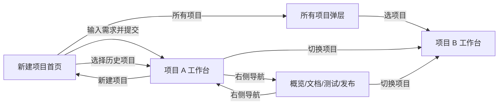

# MYATOM 桌面界面设计 · 统一入口

> 版本：V7 视觉基线＋2026-11-01 当前卡下单一发送交互修订 · 状态：**当前设计要求**。V7 可点击原型保留为修订前的历史参考；本轮正式工作台的实现与验收见 [ADR-010](../docs/decisions/ADR-010-structured-card-single-send.md)、[ADR-011](../docs/decisions/ADR-011-decision-turn-composer.md) 和[单一发送 TC](../tests/cases/SINGLE-SEND.md)，原型仍不等于正式功能证据。

## 从这里看

- [查看修订前 V7 原型](http://127.0.0.1:8765/prototype-v7/#/) · [原型说明与评审截图](prototype-v7/README.md)
- [设计 Harness：反馈、决策、验收检查](harness.md)
- [统一设计 Token](token.json)
- [品牌 VI 与图标](v3/VI.md) · [动效原则](v3/MOTION.md)
- [PRD](../docs/PRD.md) · [架构](../docs/ARCHITECTURE.md) · [变更守则](../docs/decisions/ADR-002-change-control.md)

`design.md` 是当前设计入口；[INTERACTIONS.md](INTERACTIONS.md) 已同步本轮交互修订。`design/tokens.json`、`design/TOKENS.md`、`design/README.md` 及 V2/V3 页面图是早期记录。视觉参照沿用 V7；对话、过程信息和右侧显隐以本文件新规则为准。正式产品需求仍以 PRD/架构为准。`token.json` 尚未自动驱动 V7 CSS。

## 设计定位

MYATOM 是**对话形式的 AI Agent 产品**。中间让用户与 Agent 连续完成澄清、计划、生成和迭代；有相应产物或用户主动查看文档时，右侧才承载预览、文件与状态。左侧用于历史项目。三栏是可按阶段出现的职责分配，不是始终等权、始终占位的信息面板。

整体风格是暖白“制作台”：纸白主内容、深绿色导航与可用状态、陶土橙用于当前待决定事项。标题与正文形成层次，结构线轻，预览有清楚的独立应用边界。图标使用同一线性体系；MYATOM Agent 的身份标记固定为左上角同源 `brand-mark.svg`，历史和当前回复一致。装饰和特效只在解释状态变化时使用，避免卡片墙、发光粒子、假进度和无意义说明。

## 六个 URL 视图与附属状态

| 视图 | 路径 | 页面焦点 | 保持/替换 |
| --- | --- | --- | --- |
| 新建项目首页 | `#/` | 中央需求输入；下方恰好三个样例卡 | 左侧保留历史项目；“所有项目”为弹层 |
| 工作台 | `#/projects/:id` | Agent 对话与当前任务；有可用版本时可打开右侧预览/代码 | 当前项目的核心工作视图 |
| 项目概览 | `#/projects/:id/overview` | 当前阶段、目标、下一步、最近版本 | 用户打开后显示右侧内容，对话保持 |
| 项目文档 | `#/projects/:id/docs` | 已形成的需求、计划、决定、文件 | 用户打开后显示右侧内容，对话保持 |
| 测试 | `#/projects/:id/tests` | 已执行检查、证据与阻塞 | 用户打开后显示右侧内容，对话保持 |
| 发布 | `#/projects/:id/publish` | 已具备的就绪条件、发布状态与真实链接 | 用户打开后显示右侧内容，对话保持 |

“所有项目”弹层、项目切换弹层、预览/代码页签、文档分节、日志展开、澄清/计划/构建/结果卡、右栏收起/放大都是上述页面内的交互状态，不另算主页面。V2 文档中的“项目中心列表页”已由当前 V7 原型的简洁首页＋所有项目弹层取代。

## 主工作台结构

| 区域 | 内容与优先级 | 交互 |
| --- | --- | --- |
| 左侧历史项目 | MYATOM 标识、所有项目、新建项目、搜索与历史项目；只给项目名与必要阶段 | 选择项目切到该项目工作台；当前项清晰标示 |
| 中间对话 | 项目需求、Agent 澄清、用户回答、Agent 计划、用户确认、真实进度与结果按时序排列；当前待处理卡嵌在对应 Agent 回复中；底部持续输入 | 查看历史/回到当前；回答澄清、修改/确认计划、继续迭代；常规视图不显示原始过程记录、模型调用数或 Token |
| 条件式右侧内容 | 有可用版本时显示预览/代码与相关证据；用户主动查看已形成的计划文档时也可打开 | 无可用版本默认不占空间；打开后同项目切视图只替换本区，右栏可收起或放大 |

默认左栏 220px。无可用版本且未主动打开右侧时，中间对话占满剩余工作区；右侧打开后，中间约 56%、右侧约 44%，并按可用宽度夹紧。可见分隔线支持拖动与键盘调整，可恢复默认，布局偏好存本机；右侧隐藏时不显示其分隔线。目标为桌面 1280×720、1366×768、1440×900；不设计 MYATOM 手机专用界面。完整数值见 [token.json](token.json)。

## 用户旅程与跳转规则

1. **新建**：用户输入需求；样例卡只填入可编辑草稿，提交才创建项目并进入该项目工作台。首页不以全量项目列表抢占主视觉。
2. **同项目切视图**：用户从对话中的“查看计划文档”等入口或已打开的右栏导航进入相应视图；右栏按需打开，URL 与内容同步。中间对话保持挂载，输入草稿和阅读位置保留。右栏页面各自可以记住局部阅读位置。前进/后退与 URL 一致；直接打开文档 URL 也应展示已形成的文档。
3. **跨项目切换**：左栏历史、当前项目选择器或“所有项目”弹层选择另一项目，统一进入目标项目的工作台；项目名、对话、右栏、阶段和 URL 同步。旧项目草稿按项目隔离；不得瞬间显示旧数据配新标题。
4. **对话流程**：用户需求 → Agent 澄清卡 → 用户发送的原文/答案 → Agent 解释结果 → Agent 计划卡 → 用户明确批准/修改 → Agent 生成进展 → Agent 结果。每条回复按服务端事实进入时间线；已完成的交互卡变为可回看的只读摘要，当前待决卡留在对应 Agent 回复内，只采集答案或展示证据。当前决策卡下方的“发送”是澄清、计划、构建失败等待态唯一的对话提交入口；“采用建议”仅选择答案。进展用简短自然语言呈现真实阶段、已完成事项、失败原因与下一步；常规用户对话不出现“过程记录”列表、模型调用数、Token、内部 run ID 或常驻“运行详情”卡。用户查看历史时，新进度不强迫滚到底。
5. **结果与文件**：无可用版本时右侧默认不出现，也不以重复的目标和空预览占空间；计划形成后可由对话主动打开项目文档。首个可用版本完成后，右侧预览/代码入口变为可用，并可自动展示一次；用户再次收起后尊重其选择。已有旧版的项目开始新一轮生成时，可继续查看旧版，但必须标注当前展示的版本。预览、代码、测试内容按真实项目和版本关联；未测试、未发布不能用示例数据冒充事实。
6. **异常与求助**：发生失败时，在对应 Agent 结果消息中解释原因、保留的可用版本与可执行下一步；展示可复制的错误 Trace ID 便于求助。详细模型调用、Token、工具日志和内部事件只留在受控诊断/管理员渠道，不作为普通用户对话内容。
7. **构建失败人工处理**：自动修复耗尽后仍留在当前对话，先展示一句基于构建证据的原因、最近错误和尝试次数；历次命令与错误可展开。当前失败卡下方的统一输入区发送“再修复一次”、具体源码修复方向或“用现有代码重新构建，不改文件”；卡内无重复提交动作。环境故障不允许改码；旧终态构建失败先提供“查看修复选项”。具体流程见 [ADR-008](../docs/decisions/ADR-008-manual-build-recovery.md) 与 [ADR-010](../docs/decisions/ADR-010-structured-card-single-send.md)。

## 长任务进展

额度耗尽时在当前 Agent 回复中显示“当前任务已暂停”、具体触发原因，以及模型调用、Token、Agent 执行时间和自动修复轮次的已用/当前/确认后上限。已耗尽项默认选中，其他项可选；底部仅有一个“确认扩额并继续”提交动作。确认后在对话时间线留下简短的用户决定摘要，原 run 从检查点继续。旧额度终态显示“查看扩额选项”，由用户主动打开确认卡。详见 [ADR-015](../docs/decisions/ADR-015-owner-confirmed-budget-extension.md)。

自动修复只因轮次上限而停机时，现有人工处理卡提供“选用：增加 30 轮自动修复并继续”，它只填写下方输入区；用户发送后才增加上限并继续。错误无进展或循环停机不提供该选项。

按 [ADR-012](../docs/decisions/ADR-012-user-facing-run-progress.md) 在当前对话里显示一条不断更新的进展：标题是当前用户可理解阶段，正文先说本轮已确认/已完成什么，再说下一步，右上角显示服务端累计执行时间。等待用户时计时停止，当前决策卡仍是焦点。计划卡以空圆列出 `tasks`，明确“尚未开始”；批准后才显示独立的执行检查，勾选必须来自实际事件。构建结果展示执行过的命令；静态资源检查明说浏览器交互未检查。完成/失败/取消/待人工修复时，结果或处理动作在前，过程清单默认折叠。

## 首页、排版与动效

- 首页参考常见对话产品的聚焦方式：居中的 H1、单个大输入框和三个可选起点；历史项目留在左侧。删除 H1 上方无语义菱形与冗余引导句。
- H1 依次显示“今天想做什么？”“快速产出产品模型？”“一个绝妙的主意！”，逐字出现、停顿、逐字删除并循环。标题区域固定高度，避免布局跳动；减少动态效果时静态显示第一句，屏幕阅读器获得稳定的标题。
- 全局字体按 [V7 Token](token.json) 放大：正文 18px，对话 17px、标签 16px，辅助信息最低 14px，主页 H1 50px。正文用系统中文无衬线；首页大标题可用宋体；文件名与日志用等宽字体。
- 动效用于弹层、右侧内容切换和操作反馈；不制造虚构进度。减少动态效果时即时切换，所有状态仍通过文字与图标表达。

## 评审图片

| 画面 | 图 |
| --- | --- |
| 简洁新建页 | [01-new-project.png](prototype-v7/screenshots/01-new-project.png) |
| 主工作台 | [02-workbench.png](prototype-v7/screenshots/02-workbench.png) |
| 1280×720 工作台 | [03-workbench-1280.png](prototype-v7/screenshots/03-workbench-1280.png) |
| 1280×720 澄清卡 | [04-clarify-1280.png](prototype-v7/screenshots/04-clarify-1280.png) |
| Agent 对话历史与统一头像 | [05-dialogue-history.png](prototype-v7/screenshots/05-dialogue-history.png) |

## 确认记录与实施边界

- **原型确认与修订**：2026-10-31，用户先确认 V7 视觉原型，随后明确要求对话化呈现、隐藏面向开发者的过程信息、在无可用产物时默认不占用右侧空间。这些新交互规则覆盖原型中的“过程记录”与常驻右栏示例；原型代码和截图仍是修订前状态，不能作为新规则已实现的证据。
- **样例差异**：PRD 规定首页三例为“番茄钟待办、点老头游戏、移动点单”；V7 展示“每周支出记录、番茄钟待办、周末行程”。V7 的展示已作为原型内容接受；将其替换到正式产品涉及验收案例，仍需单独对齐 PRD。
- **主题差异**：PRD MVP4 仍要求默认与二次元主题；V7 只呈现默认主题，不代表取消第二主题。
- **能力边界**：原型中的项目、Agent 轮次、版本、预览、测试和发布均为模拟。正式产品必须用服务端事实与执行证据渲染，不从原型截图推断能力已实现。

后续原型修订按 [harness.md](harness.md) 的 DH-01～DH-09 逐项回归；正式产品实施另核对 PRD 差异、真实状态与功能测试。
