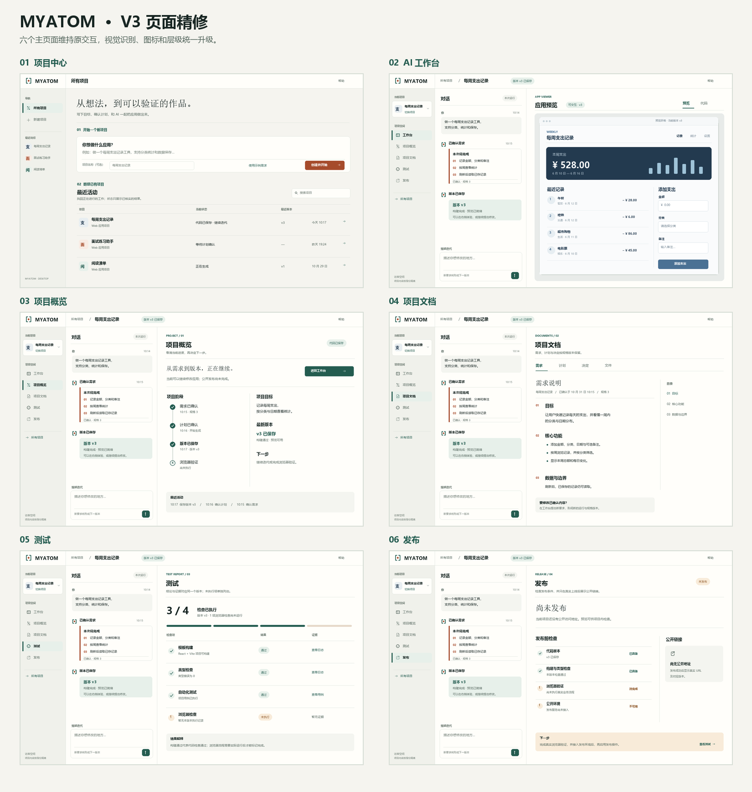

# MYATOM V3 视觉精修版

沿用 [V2 六页结构与交互](../INTERACTIONS.md)，落实[设计侧决策](../DECISIONS-v3.md)。本版只更新视觉与状态反馈，不新增主页面或改变项目切换规则。

## 交付清单

| 产物 | 内容 |
| --- | --- |
| [VI 视觉板](vi-board.png) | 品牌标记、字标、色彩比例、字体、图标、动效分镜 |
| [品牌规范](VI.md) | Logo、页面气质、外壳与生成应用的边界 |
| [图标规范与 SVG](icons/README.md) | 5 个项目导航图标、品牌标记和字标 |
| [动效规范](MOTION.md) | 触发、时长、结束与减少动态效果 |
| [Token](tokens.json) | 本版语义色、字阶、空间、组件和动效数值 |
| [六页总览](pages/00-contact-sheet.png) | 六个主页面的视觉对照 |

## 页面图

| 页面 | 示意图 |
| --- | --- |
| 项目中心 | [01-projects.png](pages/01-projects.png) |
| AI 工作台 | [02-workbench.png](pages/02-workbench.png) |
| 项目概览 | [03-overview.png](pages/03-overview.png) |
| 项目文档 | [04-docs.png](pages/04-docs.png) |
| 测试 | [05-tests.png](pages/05-tests.png) |
| 发布 | [06-publish.png](pages/06-publish.png) |
| 项目切换弹层（非独立页面） | [07-project-switcher.png](pages/07-project-switcher.png) |

## 使用边界

全部页面图使用虚构项目和状态以检验视觉结构。v3、生成应用、测试和发布状态均是设计样例；当前产品可用能力仍以服务端和 [PRD](../../docs/PRD.md) 为准。没有有效预览时显示真实版本/结果状态，没有公开发布能力时显示阻塞条件。生产前端尚未按这些图改动。

图像由 [render_v3.py](render_v3.py) 从固定样例绘制；SVG 图标为可编辑源文件。目标仅为 MYATOM 桌面建造工作台；生成应用的移动端适配独立决定。
