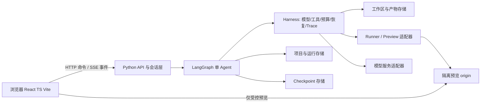
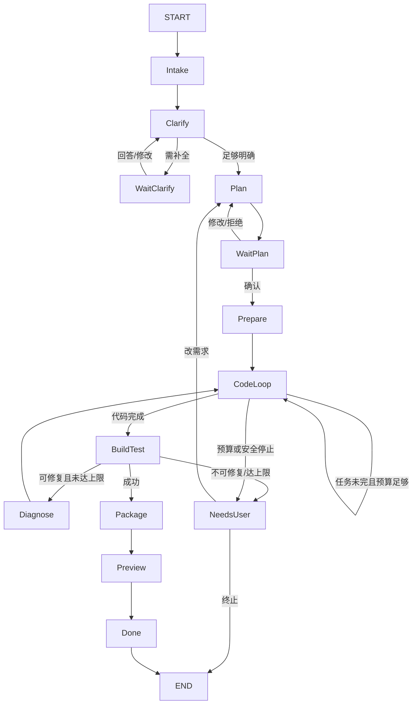

# MYATOM 系统架构（v0.1）

状态：设计基线，2026-10-30；2026-10-31 按用户确认的 [ADR-004](decisions/ADR-004-generated-deliverable-boundaries.md) 修订生成交付物边界。产品范围见 [PRD](PRD.md)；平台部署决策依赖本机 `D:\AI\ATOM笔试\docs\ATOMS-SPIKES.md` 中的实测记录。固定与待定边界见 [ADR-001](decisions/ADR-001-baseline.md)，冲突处理见 [ADR-002](decisions/ADR-002-change-control.md)。

## 1. 原则与系统边界

固定 React + TypeScript + Vite 作为**生成应用模板**及主 Web 前端的优先方案；Python + LangGraph 编排**一个主 Agent**，不为演示而拆多 Agent。模板控制依赖、目录、构建命令和可预览能力。节点是确定性工作流阶段，Agent Loop 只在确需模型决策、工具选择或修复时运行。每次确认与外部副作用都有持久边界。基础设施和沙箱只定义接口，具体实现由 Spike 决定。



本地建议一个 Python API 服务和受控 worker，SQLite 保存应用记录与 checkpoint，项目产物存于非公开数据目录。生产可换 Atoms Cloud 或独立托管，但适配器必须通过相同契约。浏览器从不直接调用模型服务或读取服务器文件。

下文的 `ProjectRepository`、checkpointer、事件表与异常库属于 **MYATOM 平台**，可以使用服务端数据库；生成交付物自己的业务数据限其预览 origin 下的 `localStorage`。同一项目跨版本保持稳定 origin，不同项目须使用隔离 origin；项目 ID 作为存储键前缀不能阻止同源代码读取其他项目的数据。生成交付物若包含后端，只能有一个进程、一个监听端口，且不得用服务端数据库/缓存保存业务数据；MYATOM 的主 API、预览网关、独立异常后台不计入该限额。

跨项目异常后台是[独立部署单元](EXCEPTION-OBSERVABILITY.md)：主服务只向统一数据库写入安全异常字段；运维前后端单独运行，以只读连接查询该数据库，不通过主 API 获取跨项目数据。独立部署和数据库边界记录于 [ADR-003](decisions/ADR-003-exception-console.md)。

## 2. 组件与可替换接口

| 接口 | 责任/最小方法 | 本地候选 | 生产候选与未决 |
| --- | --- | --- | --- |
| `ProjectRepository` | 项目/会话/版本 CRUD、乐观版本检查、按 owner 查找 | SQLite | Atoms DB 或外部 SQL；需验证可编程访问、迁移与事务 |
| `CheckpointRepository` | 按 `thread_id` 恢复 LangGraph 状态 | SQLite checkpointer | 持久化 checkpointer；Atoms DB 可用性待测 |
| `EventLog` | 原子追加 `seq`、按 `after_seq` 回放 | SQLite | 同数据库或可重放事件存储 |
| `ArtifactStore` | 按项目/运行/版本保存源码、构建日志、manifest | 本地非公开目录 | Atoms App Storage 或对象存储；路径/权限待测 |
| `GeneratedAppStorage` | 在生成模板内封装带项目/应用命名空间的浏览器 `localStorage` 读写与格式校验；只存生成应用业务数据 | 预览 origin 的浏览器存储 | 同 origin 的 Web 存储；不使用平台 DB/SQL/缓存保存交付物业务数据 |
| `ModelGateway` | 统一消息、结构化输出、token 用量、超时、取消 | 本地配置的模型 API | Atoms AI Library 或外部模型 API；后端调用方式待测 |
| `Runner` | 创建隔离工作区、构建/测试、限额、停止、清理 | Docker 优先 | 独立隔离执行服务；Atoms 自带沙箱能力待测 |
| `PreviewGateway` | 发布版本、返回受限 URL、停止/过期 | 容器独立 origin | Atoms 预览或外部预览；可用性待测 |
| `SecretProvider` | 服务端按环境取凭证 | 本地环境配置 | Atoms Keys 或托管密钥；禁止注入生成项目 |

适配器不向上层暴露供应商数据库字段或模型专属消息格式。MYATOM 项目/会话/运行/版本与生成应用业务数据分属服务端和浏览器两个边界。平台迁移以导出 manifest、源文件、项目/会话记录为单位；浏览器业务数据不随平台迁移或代码快照自动搬迁，不假设平台发布会自动迁移本地数据。

生成应用的持久化采用固定模板的 `GeneratedAppStorage` 适配：计划卡确定所需数据结构，Agent 写 React 页面与受控的本地读写逻辑，按命名空间/版本格式校验浏览器数据。预览网关须为每项目提供跨版本稳定、彼此隔离的 origin，才可同时验收刷新读回与跨项目隔离；预览不能调用主 Agent 管理 API，也不能持有数据库凭证或密钥。浏览器存储容量、清理存储、跨设备和旧版数据格式不兼容都需在产品中说明。生成应用后端为可选能力，最多一个进程/一个端口，只做不持久化业务数据的逻辑；超出范围的需求在计划卡中说明并要求缩减。

## 3. API、会话与事件

- `POST /api/projects` 创建项目；`GET /api/projects/{id}` 恢复；`GET /api/projects` 列表。
- `POST /api/projects/{id}/runs` 用 `Idempotency-Key` 提交需求，返回 `run_id`，同一项目仅允许一个活动 run。
- `POST /api/runs/{id}/decisions` 传 `card_id`、`spec_version`、动作、结构化答案与幂等键；服务端校验当前等待状态和版本。计划确认才可进入写代码。
- `GET /api/runs/{id}/events?after_seq=n` 回放；`GET /api/runs/{id}/stream?after_seq=n` SSE 实时流。事件包含 `event_id`、单调 `seq`、`run_id`、`type`、`schema_version`、`at`、脱敏 `payload`；客户端按 `seq` 去重。
- `GET /api/projects/{id}/versions`、`GET /api/versions/{id}/preview` 查询产物与预览；`POST /api/runs/{id}/cancel` 请求取消。
- 项目快照返回持久的 `active_version_id`；回滚命令携带目标 `version_id` 和幂等键，经项目权限与快照可用性校验后原子更新当前指向，不复制产物、不调用 Agent。具体路由由实现契约确定。

现有 `/app-data/{project_id}/{entity}` 属于先前 MVP2 的生成应用服务端 CRUD 实现，**不属于新的目标接口**；当前单一 `127.0.0.1:8001` 预览 origin 也不能隔离不同项目的 `localStorage`。迁移前必须在实施和测试记录中标明这些差距，不能把旧数据服务或项目 ID 键名前缀当作新边界的证据。

连接层：SSE 建联后立即发送当前状态和游标，每 15 秒心跳（配置值）；断开时指数退避并加抖动重连，携带最后 `seq`；重连先补历史再接实时。刷新后以服务端状态为准，活动流不能依赖仅存在内存的 token stream。SSE 失败可轮询回放 API。连接恢复不重新提交生成命令。API 身份与访问控制在 MVP1 可使用服务端签发的访客凭证；公开部署前必须证明项目之间不可互读，不把可猜测 ID 当授权。

## 4. 状态、检查点与版本

LangGraph `thread_id` = `run_id`，与项目 ID 分开。状态只保留可恢复的原始事实与引用，不把完整文件、密钥、长日志或渲染后的 prompt 放进 checkpoint。

```text
RunState = {
  project_id, run_id, owner_id, phase, status, request_text,
  clarification: {questions, assumptions, answers, revision},
  spec: {requirements, pages, data_model, acceptance, template_version,
         version, approved_version, approved_by, approved_at},
  plan: {tasks, current_task, revision},
  workspace_ref, artifact_manifest_ref, last_good_version_id,
  build: {attempt, diagnostics_ref, test_summary, preview_ref},
  budget: {token_limit, cost_limit, time_limit, used_tokens, used_cost,
           tool_calls, deadline_at},
  recovery: {node_attempts, fix_rounds, last_error_code, cancel_requested},
  trace_id, event_seq
}
```

存储事务保证：确认记录、状态转移、事件追加使用同一个业务事务；文件产物以临时目录写入后原子更名，再提交 `artifact_manifest_ref`。checkpoint 是流程恢复依据，业务记录是 UI/审计依据；两者不共享同一“写入成功”的假设，启动时执行一致性修复。确认卡采用 `spec_version` 乐观锁，过期确认返回冲突和最新卡片。

版本目录与项目记录分开：`RunState.last_good_version_id` 是运行中的参考，项目级 `active_version_id` 才是预览/回滚的当前指向。只有构建和预览可用性检查通过的完整源码、资源、锁文件、manifest、构建产物及测试引用进入不可变可用快照。成功发布先持久化新快照并原子切换当前指向，再淘汰最早且非当前的快照，使每项目最多保留 5 个可用版本；失败不切换、不淘汰。回滚原子切换到现存可用快照，不新增版本；重复请求幂等。清理旧快照须在元数据提交后执行，并能在中断后补偿，不能产生悬空指向。`approved_spec_version` 是计划确认版本，不等同交付物 `version_id`。

**持久点**：项目创建；澄清卡发出/用户回答；计划卡发出/确认；生成前；每次工具副作用后；构建测试后；修复循环每轮；版本发布前后；取消/预算停止/异常。LangGraph 节点边界形成 checkpoint，关键人工确认使用 `interrupt()` 和持久 checkpointer；对外部副作用另做幂等账本。恢复中断的节点可能重新执行，不能只靠 checkpoint 防止重复副作用。[LangGraph 官方说明](https://docs.langchain.com/oss/python/langgraph/interrupts)。

## 5. LangGraph 主流程



| Node | 输入 → 输出与工具 | 分支 / checkpoint |
| --- | --- | --- |
| `Intake` | 原始需求、项目身份 → 清洗后的目标/约束；仅校验/项目读取 | 无效输入终止；保存原始输入与 run |
| `Clarify` | 目标、历史回答 → 问题/假设或完整 spec；模型结构化输出 | 有关键缺口去 `WaitClarify`，否则 `Plan`；保存卡片版本 |
| `WaitClarify` | 澄清卡 → 经验证答案；不调用生成工具 | `interrupt()` 等待；修改后回 `Clarify`；保存确认事件 |
| `Plan` | 已澄清 spec → 页面、数据模型、任务、验收点与预算估计 | 生成计划卡，保存 revision；不得写生成项目 |
| `WaitPlan` | 计划卡 → `approved_spec_version` 或修改意见 | `interrupt()`；退回 `Plan`；确认事务后才放行 |
| `Prepare` | 已确认计划 → 固定模板快照、工作区、任务游标 | 幂等创建工作区；保存模板版本与 manifest |
| `CodeLoop` | 当前任务、模板文件索引、上下文摘要 → 工具调用和代码修改 | **Agent Loop**：模型决策→受控工具→观察→校验，任务完成/最大步数/预算/取消退出；每次副作用记录 |
| `BuildTest` | 工作区 → 构建、测试、诊断摘要 | 成功进 `Package`；失败按可修复性、次数路由；保存原始日志引用 |
| `Diagnose` | 错误分类、日志片段 → 定位与修复任务 | **回退分支**到 `CodeLoop`；限最多 2 轮（初值，可校准） |
| `Package` | 通过的工作区 → 候选不可变源码/构建产物、hash、测试报告 | 原子写入候选产物；可重试；尚不淘汰旧版 |
| `Preview` | 候选版本 ID → 隔离 URL 或安全失败状态 | 可用性检查通过才登记可用快照、切换当前指向并按 5 版上限清理；失败进 `NeedsUser` 且保留旧版 |
| `NeedsUser` / `Done` | 错误/结果 → 可操作的测试卡和最终状态 | 终态持久化；下一次修改建新 run |

`Clarify` 与 `Plan` 各是短的模型推理步骤；只有 `CodeLoop` 是工具使用循环。`Diagnose → CodeLoop` 是编译/测试失败回退。用户编辑已确认需求时新建 spec/run，不直接篡改正在构建的 checkpoint。LangGraph 原生 checkpoint、interrupt 和节点划分依据见 [官方思路](https://docs.langchain.com/oss/python/langgraph/thinking-in-langgraph)与[持久化说明](https://docs.langchain.com/oss/python/langgraph/persistence)。

MVP5 若启用跨对话记忆，另设 `MemoryStore`，只存有来源/时间/可撤销标记的事实偏好、跨项目资料引用、已完成技能记录和历史结论。写入前展示候选并允许更正；读取时按用户/项目作用域过滤。它不复用 run checkpoint，因为 checkpoint 只覆盖当前线程。

## 6. Harness 约束

### 模型与上下文

`ModelGateway` 统一结构化响应、工具调用、token 用量、超时与错误；每个阶段使用 schema 校验和最多一次格式修复，仍失败转可见错误。供应商切换只替换适配器，不让模型自选权限。上下文由“当前批准 spec + 模板 manifest + 当前任务 + 相关文件片段 + 最新构建错误 + 压缩历史”组成；工具结果保留原始引用和短摘要，超过阈值按文件/错误相关性检索，摘要不覆盖已确认事实。保存 prompt/template/schema 版本用于重放，敏感值不进上下文。

### 阶段工具权限

| 阶段 | 允许 | 禁止 |
| --- | --- | --- |
| Intake / Clarify / Plan | 读取项目事实、模板元数据；模型生成结构化卡片 | 写文件、执行命令、外网、发布 |
| Prepare / CodeLoop | 在指定工作区列目录、读文件、补丁写文件、受限依赖命令 | 主仓库/宿主任意路径写入、读取密钥、部署 |
| BuildTest / Diagnose | 构建/测试命令、受限日志读取 | 任意命令、生产数据写入 |
| Package / Preview | 产物打包、经 Runner/Preview 发布候选版本 | 让模型直接操作部署凭据或平台管理接口 |

工具调度由服务端阶段 allowlist 和路径/参数验证执行；模型返回的工具名和参数一律视为不可信输入。依赖安装要锁版本、限制网络与资源；下载执行脚本需单独策略，不默认允许。

### 异常、预算与追踪

- 将错误分为瞬时（429/超时/5xx）、可由 Agent 修复（编译、类型、测试、schema）、需用户补充（需求/权限/额度）和不可安全继续（越权、沙箱缺失）。瞬时错误最多 3 次指数退避加抖动；重试前检查取消和总预算。非幂等操作不自动盲重试。
- 工具操作键 = `run_id + node + task_id + intent_hash`。写文件使用期望 hash/临时文件原子替换；建版本用唯一键；执行失败先读取操作账本和现有产物再决定重试。取消时停止子进程并保留日志与最后好版本。
- 单 run 的默认初值：最多 30 次模型调用、2 轮修复、15 分钟、预算额度由配置设置；硬上限任一触发即停止。数值是待校准的产品保护阈值，不是平台额度。记录估算与实际 token/费用，模型无用量信息时保守估算。
- `trace_id` 贯穿 API、node、模型与工具；span 包含输入引用 hash、输出摘要、耗时、重试、用量、错误码、版本。日志/事件脱敏，不能记录密钥或用户生成应用的私有业务数据。

## 7. 生成产物与预览隔离

产物目录建议 `data/projects/{project_id}/runs/{run_id}/workspace`，版本在 `data/artifacts/{project_id}/{version_id}`；路径由服务端 ID 构造且 canonicalize，不能接受用户拼接路径。工作区与应用代码仓库分开。manifest 记录模板版本、源 hash、依赖锁、构建/测试结果、预览配置。可生成的 Web 应用限固定 React + TypeScript + Vite 模板的前端入口、静态资产、`GeneratedAppStorage` 及符合单进程/单端口边界的可选后端；生成项目不得访问主应用的数据库/密钥。业务 `localStorage` 数据不进入产物快照，代码回滚不改写该数据；旧代码与现有数据格式兼容性不在本轮保证范围。

**Docker 可用时**：每 run 独立非 root 容器，资源/时长限制、只挂载工作区、默认无宿主网络及密钥，依赖下载阶段与运行阶段分离；预览通过独立 origin 和受限代理访问，禁止同源权限继承，设置 CSP、sandbox iframe、短期 URL 和反向代理路径检查。Docker 本身也需本地实测。

**同宿主 fallback**：仅用于本地、可信操作者且不接受公开用户任意代码的短期开发；最小进程权限、独立目录、CPU/时间限制及不同 origin 只能减小风险，**不能视为安全沙箱**。在该模式下不公开交互式代码执行；线上必须有可信隔离 Runner，或把范围缩到不执行生成代码的静态受限预览（此时不能声称满足最终 Demo 的真实交互验收）。Atoms 是否提供足够的沙箱或可运行 Python 服务均未验证，见本机 Atoms Spike 过程记录。

## 8. 运行风险与验证映射

| 风险 | 设计处理 | 验证 |
| --- | --- | --- |
| 平台不能运行 Python/LangGraph | API/模型/存储/Runner 适配器；外部服务托管备用 | S4、S5 |
| Cloud DB 不可直接用作 checkpointer | 外部持久 SQL；导出/迁移记录 | S2 |
| AI Library 仅供 Atoms Agent 接入 | `ModelGateway` 改用外部模型 API 与服务器密钥 | S3 |
| GitHub 无法直连现有仓库 | 新建私人仓库后在隔离分支拉入，或文件上传/外部部署 | S1、S8 |
| 预览执行逃逸/密钥泄漏 | 独立 Runner/origin/密钥边界；无隔离不公开执行 | S6 + 安全 TC |
| 发布与开发环境行为不一致 | 同一端到端 TC 分别跑 Preview 与公开链接 | S7 + 端到端 TC |

验收 TC 分类和维护责任见 [PRD §7](PRD.md#7-测试与-tc-维护)。

## 9. 非功能验收初值

- 正确性：同一幂等键重复提交只对应一个 run/确认/产物；同项目事件 `seq` 严格递增；跨项目读取被拒绝。以自动化 TC 验证。
- 恢复：服务重启后项目、等待确认、最后好版本可恢复；SSE 中断后回放缺失事件。以断网/重启故障注入验证。
- 体验：本地开发环境项目列表与已存卡片的 95% 请求在 2 秒内返回；生成期间每个 Node 转移后 3 秒内出现阶段事件。模型与构建耗时单独展示，不伪装为页面卡顿。该目标在校准阶段按实测调整。
- 资源：单项目同时一个活动 run；每 run 最大模型调用、修复轮数与总时长见 §6。Runner 的 CPU、内存、磁盘与网络配额在选型 Spike 后量化，未量化前不允许公开执行不可信代码。
- 可观测：每次 run 能按 `trace_id` 串起确认、模型、工具、构建、预览与失败；日志脱敏；测试证据关联版本 ID。
