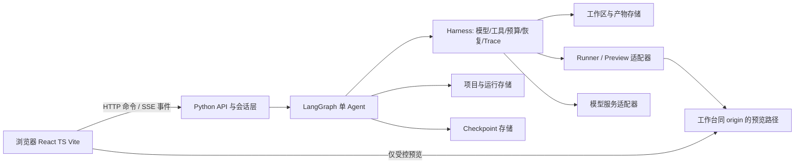
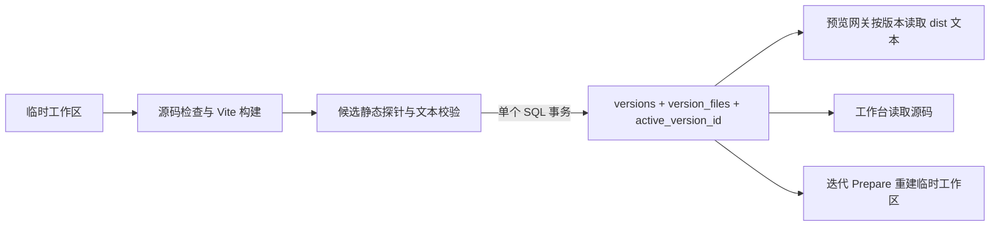
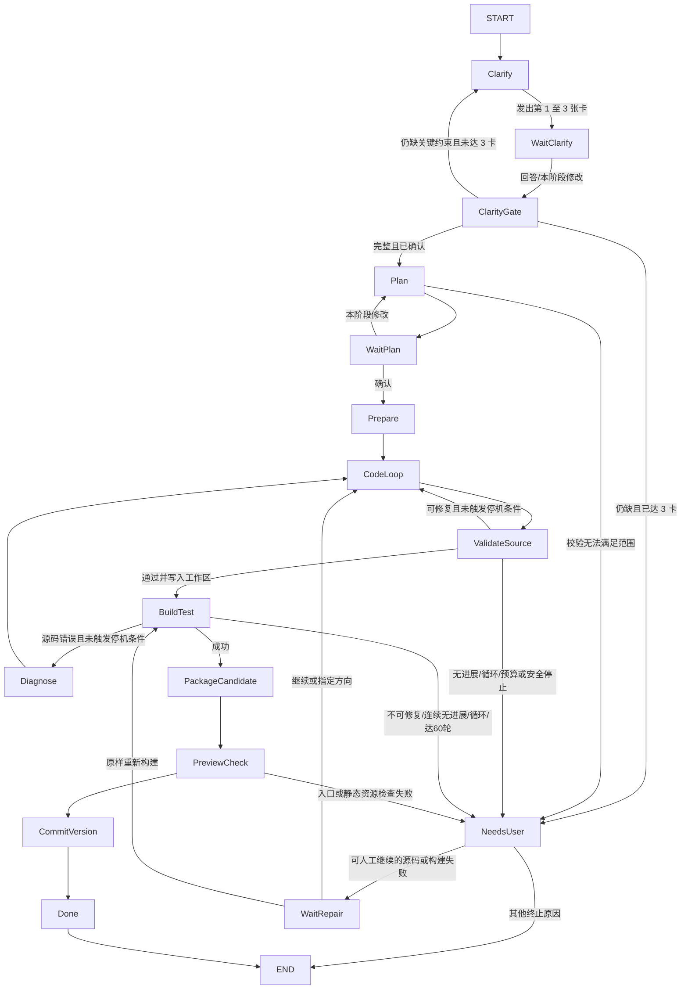

# MYATOM 系统架构（v0.1）

状态：设计基线，2026-10-30；2026-10-31 按用户确认的 [ADR-004](decisions/ADR-004-generated-deliverable-boundaries.md) 修订生成交付物边界；2026-11-01 按 [ADR-006](decisions/ADR-006-single-main-run-scope.md) 收束为单次主线交付，并按 [ADR-010](decisions/ADR-010-structured-card-single-send.md) 增加当前等待卡的消息解释层。GitHub → Azure 路线按 [ADR-014](decisions/ADR-014-atoms-deployment-and-model-credentials.md) 选定，受信演示边界见 [ADR-020](decisions/ADR-020-azure-files-trusted-demo.md)，Azure SQL 数据库决定见 [ADR-021](decisions/ADR-021-azure-sql-platform-state.md)，版本文本存储见 [ADR-023](decisions/ADR-023-azure-sql-text-artifacts.md)；本地 SQLite 版本存储见 [ADR-024](decisions/ADR-024-sqlite-local-artifacts.md)；用户模型 Key 当前规则见 [ADR-028](decisions/ADR-028-browser-model-key-both-environments.md)，历史决定见 [ADR-025](decisions/ADR-025-browser-model-settings.md)。2026-11-01 用户以 [ADR-026](decisions/ADR-026-shared-origin-project-storage.md) 将每项目独立预览 origin 改为共享 origin 与项目 ID 键前缀；2026-11-02 按 [ADR-027](decisions/ADR-027-azure-sql-trusted-demo-network.md) 调整 Azure SQL 受信演示网络访问。产品范围见 [PRD](PRD.md)，冲突处理见 [ADR-002](decisions/ADR-002-change-control.md)。

## 1. 原则与系统边界

固定 React + TypeScript + Vite 作为**生成应用模板**及主 Web 前端的优先方案；Python + LangGraph 编排**一个主 Agent**，不为演示而拆多 Agent。模板控制依赖、目录、构建命令和可预览能力。节点是确定性工作流阶段，Agent Loop 只在确需模型决策、工具选择或修复时运行。每次确认与外部副作用都有持久边界。Azure 存储目标由 ADR-021 与 ADR-023 选定，接口继续可替换；受信演示的同容器 Runner 不构成沙箱。

当前 Graph 目标只覆盖**一个简单需求在一个 run 内生成一版可用交付物**。不增加按消息语义决定“新建内容 / 修改内容 / sidecar 聊天”的入口路由，也不为复杂需求自动跳回已结束阶段。当前等待卡前的消息解释器只在阶段内识别回答、修改、问题和明确批准，并把候选意图交给确定性门禁；它不是 Graph 的全局 IntentRouter，不能调用写文件工具。澄清阶段内补问、计划阶段内修改与构建错误修复是有界的局部循环；交付后修改需求启动新 run。快照代码回滚由版本服务处理，不进入该 Graph。见 [ADR-006](decisions/ADR-006-single-main-run-scope.md) 与 [ADR-010](decisions/ADR-010-structured-card-single-send.md)。



本地使用 Python API 服务和受控 worker，SQLite 保存平台记录、checkpoint、预览票据及完整版本文件，见 [ADR-024](decisions/ADR-024-sqlite-local-artifacts.md)。Azure 按 [ADR-021](decisions/ADR-021-azure-sql-platform-state.md) 与 [ADR-023](decisions/ADR-023-azure-sql-text-artifacts.md) 采用**受信演示**：主 API 容器内构建，容器自身 `/app/data` 只作临时工作区；平台记录、LangGraph checkpoint 与已提交版本的文本文件统一使用 Azure SQL；独立异常后台仍单独部署。`azure_demo` 完整工作台已上线；[ADR-027](decisions/ADR-027-azure-sql-trusted-demo-network.md) 采用允许 Azure 服务访问 SQL 的服务器规则，旧容器出口单 IP 规则已移除，项目创建与读回冒烟通过；完整 Azure 跨重启验收未通过。它不提供代码执行隔离，只允许获授权用户访问；匿名公网生产模式仍拒绝启动。实施与未验证边界见 [Azure 持久化](AZURE-PERSISTENCE.md)。浏览器不直接调用模型服务或读取服务器文件；本地模型设置接口可在严格 loopback 条件下返回 `.env` Key，两端均在用户点击保存后将 Key 写入当前浏览器的 `localStorage`，见 [ADR-028](decisions/ADR-028-browser-model-key-both-environments.md)。

下文的 `ProjectRepository`、checkpointer、事件表与异常库属于 **MYATOM 平台**，可以使用服务端数据库；生成交付物自己的业务数据限工作台共享 origin 下的浏览器 `localStorage`，键名前缀为 `myatom.app.<项目 UUID>.`。同一项目跨版本复用前缀；不同项目在正常读写路径中避免键名冲突，但同源代码可读写其他项目键和工作台保存的模型 Key，前缀不构成安全边界。见 [ADR-026](decisions/ADR-026-shared-origin-project-storage.md)。生成交付物若包含后端，只能有一个进程、一个监听端口，且不得用服务端数据库/缓存保存业务数据；MYATOM 的主 API、预览网关、独立异常后台不计入该限额。

跨项目异常后台是[独立部署单元](EXCEPTION-OBSERVABILITY.md)：主服务只向统一数据库写入安全异常字段；运维前后端单独运行，以只读连接查询该数据库，不通过主 API 获取跨项目数据。独立部署和数据库边界记录于 [ADR-003](decisions/ADR-003-exception-console.md)。

## 2. 组件与可替换接口

| 接口 | 责任/最小方法 | 本地候选 | 生产候选与未决 |
| --- | --- | --- | --- |
| `ProjectRepository` | 项目/会话/版本 CRUD、乐观版本检查、按 owner 查找 | SQLite | Azure SQL；真实数据库与重启恢复待测 |
| `CheckpointRepository` | 按 `thread_id` 恢复 LangGraph 状态与 pending writes | SQLite checkpointer | Azure SQL saver；并发与重启恢复待实测 |
| `EventLog` | 原子追加 `seq`、按 `after_seq` 回放 | SQLite | Azure SQL；锁定 run 行分配序号，故障恢复待实测 |
| `ArtifactStore` | 按项目/运行/版本保存受控源码、文本构建资源与 manifest | SQLite `version_files` | Azure SQL `version_files` 为权威存储；容器 `/app/data` 为构建缓存。真实 Azure 数据库事务待验 |
| `GeneratedAppStorage` | 在生成模板 `src/hooks/` 内封装 `myatom.app.<项目 UUID>.` 前缀、读写与键名校验；只存生成应用业务数据 | 本地已实现共享 origin 的浏览器存储，Azure 待验收 | 同 origin 的 Web 存储；不使用平台 DB/SQL/缓存保存交付物业务数据；前缀不是权限边界 |
| `ModelGateway` | 统一消息、结构化输出、token 用量、超时、取消 | 用户 Key 或本地 `.env` 默认值 | 用户在浏览器配置 Key；服务端当前 run 内存使用，进程重启后重新提供；兼容性待测 |
| `Runner` | 创建工作区、构建/测试、限额、停止、清理 | 本地同宿主可信开发 | Azure 受信演示在主容器内构建；隔离证据未通过前不开放公网生成 |
| `PreviewGateway` | 发布版本、返回受限 URL、停止/过期 | 本地已实现工作台同 origin 的 `/preview/...`；Azure 待验收 | Azure 默认 HTTPS FQDN 上的共享路径预览；服务端归属与短期会话仍需实测 |
| `SecretProvider` | 服务端按环境取凭证 | 本地环境配置 | Azure 托管密钥；禁止注入生成项目 |

适配器不向上层暴露供应商数据库字段或模型专属消息格式。MYATOM 项目/会话/运行/版本与生成应用业务数据分属服务端和浏览器两个边界。Azure 环境从专用空库与空容器目录开始，**不导入本机历史项目、记录、checkpoint 或产物**；本地环境继续独立保存原数据。浏览器业务数据不随部署路径或代码快照自动搬迁。版本入库时文件行、manifest、当前指针与五版淘汰必须处于同一数据库事务（本地 SQLite，线上 Azure SQL）；预览、源码查看和迭代基线均从数据库读，不以构建目录存在为前提。

### Azure SQL 文本版本契约（Azure 实测待完成）

`version_files(version_id, relative_path, text_content, utf8_bytes, sha256, kind, mime_type)` 按 `(version_id, relative_path)` 唯一；`text_content` 使用 `NVARCHAR(MAX)`，hash 对严格 UTF-8 编码后的字节计算。只接受 [ADR-023](decisions/ADR-023-azure-sql-text-artifacts.md) 的文本扩展名、最多 64 个文件、单文件 512 KiB、每版本 2 MiB。服务端规范化相对路径，禁止绝对路径、`..`、反斜线、同名冲突与 `node_modules`。manifest 中每个文件的 hash 必须与数据库行一致，`dist/index.html` 和引用的文本资源缺一不可。



提交事务先校验当前版本仍为本 run 固定的基线，再写全部文件行和版本记录、切换当前指针、淘汰第 6 版的旧文件行；任何步骤失败整体回滚。预览仅按获授权 `version_id/path` 查询文本并设置正确 MIME、CSP 与无缓存头；SQL 不可用时返回明确错误，不能用旧容器缓存冒充可用版本。v1 已有文件仅在本地磁盘的旧版本必须检测并导入或标记不可用，不能只升级表结构后宣称可回滚。该事务与读取路径在当前代码中尚未接线。

生成应用的持久化采用固定模板的 `GeneratedAppStorage` 适配：计划卡确定所需数据结构，Agent 写 React 页面与受控的本地读写逻辑，按项目 UUID 前缀与键名格式校验浏览器数据，不允许无前缀键或 `localStorage.clear()`。预览网关已实现工作台同 origin 的共享路径；它只能保证服务端版本文件访问校验，不能阻止同源生成代码访问工作台脚本、API 与其他项目存储。用户已按 [ADR-028](decisions/ADR-028-browser-model-key-both-environments.md) 选择两端均点击保存后持久化到当前浏览器 `localStorage`；同源预览脚本可能读取保存键，不能称为凭证安全隔离。浏览器存储容量、清理存储、跨设备和旧版数据格式不兼容都需在产品中说明。生成应用后端为可选能力，最多一个进程/一个端口，只做不持久化业务数据的逻辑；超出范围的需求在计划卡中说明并要求缩减。

## 3. API、会话与事件

- `POST /api/projects` 创建项目；`GET /api/projects/{id}` 恢复项目、run、版本与已提交的决策时间线（只返回当前访客有权访问项目的决策内容，不返回幂等键）；`GET /api/projects` 列表。
- `POST /api/projects/{id}/runs` 用 `Idempotency-Key` 提交需求，返回 `run_id`，同一项目仅允许一个活动 run。
- `POST /api/runs/{id}/messages` 传 `submission_id`、`card_ref={card_id,spec_version}`、原文、结构化答案快照和可选的 `reply_to_interpretation_id`；`GET /api/runs/{id}/messages[/{submission_id}]` 读取原文、解释结果、最终动作。请求先持久化为 `interpreting`，再异步解释。服务端只对当前卡应用阶段白名单、版本乐观锁和明确批准门禁，最终决定、运行状态及事件在同一事务提交。相同键相同载荷重放同一结果，载荷变化返回 409；解释失败保留等待态。旧 `/decisions` 端点暂留给兼容调用，正式工作台只走消息接口。
- `GET /api/runs/{id}/events?after_seq=n` 回放；`GET /api/runs/{id}/stream?after_seq=n` SSE 实时流。事件包含 `event_id`、单调 `seq`、`run_id`、`type`、`schema_version`、`at`、脱敏 `payload`；客户端按 `seq` 去重。
- `GET /api/projects/{id}/versions`、`GET /api/versions/{id}/preview` 查询产物与预览；`POST /api/runs/{id}/cancel` 请求取消。
- 项目快照返回持久的 `active_version_id`；回滚命令携带目标 `version_id` 和幂等键，经项目权限与快照可用性校验后原子更新当前指向，不复制产物、不调用 Agent。具体路由由实现契约确定。

生成应用的旧 `/data/{version_id}/{entity}` 服务端 CRUD 已移除。预览网关与工作台共用同一 origin：本地工作台地址下的 `/preview/...` 路径，Azure 为该 Container App 默认 HTTPS FQDN 下的同名路径；不再依赖 `PREVIEW_BASE_DOMAIN`、项目子域或 wildcard DNS/TLS。一次性、2 分钟票据兑换为 60 分钟会话后，网关将随机会话值放在版本限定的 `/preview/s/{session}/v/{version_id}/` 路径中，静态资源经同一路径校验；服务端还须校验项目归属、规范化路径。响应禁缓存和 Referer，服务禁访问日志；工作台“重新载入”重新签发票据。共享 origin 下路径/票据不能约束浏览器脚本读写工作台及其他项目的同源资源；`connect-src 'none'` 或同源 iframe `sandbox` 也不能替代原先的 origin 隔离。`backend/preview.py` 与 `backend/api.py` 已改为同源路径，本地定向测试通过，Azure 浏览器验收仍待执行。

连接层：SSE 建联后立即发送当前状态和游标，每 15 秒心跳（配置值）；断开时指数退避并加抖动重连，携带最后 `seq`；重连先补历史再接实时。刷新后以服务端状态为准，对话轮次由卡片事件、消息及解释结果、已提交决策和 run 终态重建；原始模型事件只用于诊断，不作为访客主界面时间线。SSE 失败可轮询回放 API。连接恢复先按 `submission_id` 对账解释状态，不因重连生成新消息或重提构建命令。API 身份与访问控制在 MVP1 可使用服务端签发的访客凭证；公开部署前必须证明项目之间不可互读，不把可猜测 ID 当授权。

## 4. 状态、检查点与版本

LangGraph `thread_id` = `run_id`，与项目 ID 分开。状态只保留可恢复的原始事实与引用，不把完整文件、密钥、长日志或渲染后的 prompt 放进 checkpoint。

```text
RunState = {
  project_id, run_id, owner_id, phase, status, request_text,
  clarification: {questions, assumptions, answers, revision},
  spec: {requirements, pages, data_model, acceptance, template_version,
         version, approved_version, approved_by, approved_at},
  plan: {tasks, current_task, revision},
  workspace_ref, artifact_manifest_ref, last_good_version_id,
  source: {candidate_ref, candidate_number, output_mode, target_files,
           issues, feedback, passed, stop_code},
  build: {attempt, diagnostics_ref, test_summary, preview_ref},
  budget: {token_limit, cost_limit, active_time_limit, used_tokens, used_cost,
           tool_calls, active_seconds, execution_started_at},
  recovery: {node_attempts, fix_rounds, repair_failure_history, build_failure_history,
             build_stop_code, source_stop_code, last_error_code, cancel_requested},
  trace_id, event_seq
}
```

存储事务保证：用户消息先独立入库再返回接收回执；解释器输出是候选，最终决定、状态转移、事件追加使用同一个业务事务。两端候选目录只负责构建，受控文本文件与 manifest、版本指针在同一数据库事务提交。checkpoint 是流程恢复依据，业务记录是 UI/审计依据；两者不共享同一“写入成功”的假设，启动时分别恢复未解释消息与待处理决定。确认卡采用 `card_id/spec_version` 乐观锁，过期确认返回冲突和最新卡片。解释调用计入 Agent 执行时间，用户等待不计时；解释器只读卡片，不取得生成工具权限。

版本目录与项目记录分开：`RunState.last_good_version_id` 是运行中的参考，项目级 `active_version_id` 才是预览/回滚的当前指向。只有构建和预览可用性检查通过的完整源码、资源、锁文件、manifest、构建产物及测试引用进入不可变可用快照。成功发布先持久化新快照并原子切换当前指向，再淘汰最早且非当前的快照，使每项目最多保留 5 个可用版本；失败不切换、不淘汰。回滚原子切换到现存可用快照，不新增版本；重复请求幂等。清理旧快照须在元数据提交后执行，并能在中断后补偿，不能产生悬空指向。`approved_spec_version` 是计划确认版本，不等同交付物 `version_id`。

已有版本的新 run 在项目行锁内固定 `base_version_id` 和 `base_spec_json`；若发布前当前指针已变化，版本事务拒绝提交。计划节点把基线已确认规格与本轮变更合并为完整规格，沿用项默认保留，明确删除/替换项展示在确认卡。Prepare 从不可变基线 manifest 按 SHA-256 读入生成源码，CodeLoop 的首轮与后续局部修复均收到目标文件原文和受限依赖接口；合并后的完整候选走原源码校验、TypeScript 构建和预览探针。成功版本保存 `effective_spec` 与 `base_version_id`，失败不替换旧版本。自动检查无法证明所有旧交互仍可用，TC 必须覆盖基线与本轮变化。见 [ADR-019](decisions/ADR-019-version-inheritance.md)。

**持久点**：项目创建；澄清卡发出/用户回答；计划卡发出/确认；生成前；每次工具副作用后；构建测试后；修复循环每轮；版本发布前后；取消/预算停止/异常。LangGraph 节点边界形成 checkpoint，关键人工确认使用 `interrupt()` 和持久 checkpointer；对外部副作用另做幂等账本。恢复中断的节点可能重新执行，不能只靠 checkpoint 防止重复副作用。[LangGraph 官方说明](https://docs.langchain.com/oss/python/langgraph/interrupts)。

## 5. LangGraph 主流程

以下为当前单 run 主流程。`Clarify` 最少发出 1 张、最多 3 张卡；每张卡 1–3 道不重复问题，确认后经 `ClarityGate` 判定。计划修改只回到 `Plan`。



| Node | 输入 → 输出与工具 | 分支 / checkpoint |
| --- | --- | --- |
| `Clarify` | 目标、历史回答 → 本轮 1–3 道问题与必要假设；有界只读 ReAct，最多 3 张用户可见卡 | 每轮都去 `WaitClarify`，发卡前校验轮次、去重与预算；保存卡片版本、已问问题指纹和事实来源 |
| `WaitClarify` / `ClarityGate` | 澄清卡 → 经验证答案、已确认事实与剩余缺口；等待节点不调用模型 | `interrupt()` 等待；确认后完整则进 `Plan`，不足且未达 3 卡则继续澄清；第 3 卡仍不足进入 `NeedsUser` |
| `Plan` | 已澄清 spec → 页面、数据模型、任务、验收点与预算估计 | 生成计划卡，保存 revision；不得写生成项目。两次校验仍失败时，以固定原因码记录最后一项具体失败，在访客结果卡与独立异常记录中展示同一受控原因；不将模型原文或异常堆栈写入异常库，也不显示构建检查 |
| `WaitPlan` | 计划卡 → `approved_spec_version` 或本阶段修改意见 | `interrupt()`；修改仍在 `Plan` 阶段；确认事务后才放行；不回到 `Clarify` |
| `Prepare` | 已确认计划 → 固定模板快照、工作区、任务游标 | 幂等创建工作区；保存模板版本与 manifest |
| `CodeLoop` | 已批准需求与检查反馈 → 一份候选缓存引用 | 固定模板生成节点，不建立通用 CodeAgent 子图。问题全部定位到具体生成文件时仅输出这些文件，合并前一候选；否则输出完整映射。必含 `src/App.tsx`、`src/app.css`、根目录 `readme.md`；简单状态与业务逻辑可写在 App 或组件，复杂时再拆到 `src/hooks/`；最多 12 个生成文件、6 个组件、4 个 hook、180 KB 总量。源码布局放宽见 [ADR-029](decisions/ADR-029-generated-source-layout-relaxation.md) |
| `ValidateSource` | 候选引用 → 受控问题/反馈/具体文件或完整重生建议 | 确定性校验完整候选；只有通过才幂等写工作区并进入构建。失败保存问题码、目标文件和尝试编号，不把源码放进 checkpoint；和构建修复共用 60 轮及无进展/复现停机条件 |
| `BuildTest` | 工作区 → 构建、诊断摘要及错误指纹 | 每轮保存错误集合、停机代码、失败命令与日志引用；依赖安装/环境故障不进代码修复 |
| `Diagnose` | 仅源码编译/类型错误 → 修复任务 | **回退分支**到 `CodeLoop`；能从构建证据定位生成文件则局部重生；源码校验与构建修复合计最多 60 轮，最近 3 次错误集合相同或某具体错误第 5 次出现则提前交人工 |
| `PackageCandidate` | 通过的工作区 → 候选源码/构建产物、hash、manifest | 候选目录独立于可用版本，不占 5 版额度 |
| `PreviewCheck` | 候选产物 → 入口与静态资源可读性结果 | 当前检查等级为 `static_assets_only`，不宣称执行过浏览器交互 |
| `CommitVersion` | 通过检查的候选 → 不可变快照与 `active_version_id` | 事务入库并切换指针，成功后清理淘汰版本；失败不影响旧版 |
| `NeedsUser` / `WaitRepair` | 源码或构建结果及历史证据 → 失败小结、动作卡 | 可修复源码或构建失败暂停等待人工明确动作；每次手动操作只做一份受限候选，已有构建候选也可原样重建，再失败重新发卡。旧终态构建 run 可由项目拥有者显式恢复检查点；硬安全停止等其他失败仍终止 |
| `Done` | 构建和预览通过的候选 → 不可变可用版本 | 只在通过后提交；失败不占 5 个版本名额 |

`Clarify` 与 `ClarityGate` 组成有界澄清循环，但当前每节点只有结构化模型调用与确定性校验，不声称实现工具型 ReAct。`CodeLoop` 只生成受限候选，不做任意工具规划。`ValidateSource → CodeLoop` 与 `BuildTest → Diagnose → CodeLoop` 默认共用最多 60 轮自动源码修复，用户明确扩额后可提高轮次上限；能确定文件时只生成该文件，不能确定时才全量重生。检查点存候选引用及受控反馈，具体规则见 [ADR-013](decisions/ADR-013-source-validation-targeted-repair.md)；错误指纹停机规则见 [ADR-009](decisions/ADR-009-build-repair-harness.md)。停机后 `WaitRepair` 使用 `interrupt()` 等用户明确动作。人工源码修复每次只执行一轮，环境故障只能原样重新构建；同一 run 的硬预算不重置。`NeedsUser` 的其他终止原因仍结束。历史终态构建 run 的显式恢复见 [ADR-008](decisions/ADR-008-manual-build-recovery.md)。LangGraph 原生 checkpoint、interrupt 和节点划分依据见 [官方思路](https://docs.langchain.com/oss/python/langgraph/thinking-in-langgraph)与[持久化说明](https://docs.langchain.com/oss/python/langgraph/persistence)。

MVP5 若启用跨对话记忆，另设 `MemoryStore`，只存有来源/时间/可撤销标记的事实偏好、跨项目资料引用、已完成技能记录和历史结论。写入前展示候选并允许更正；读取时按用户/项目作用域过滤。它不复用 run checkpoint，因为 checkpoint 只覆盖当前线程。

预算暂停发生在工作线程的异常边界，不新增 LangGraph Node 或 Edge。失败节点的 checkpoint 保持原样；数据库先持久化 `awaiting_budget` 卡，确认扩额后把原阶段和活动状态恢复，工作线程重新调用原 checkpoint。用户确认与额度变更在同一事务内，双击/重试只生效一次；进程重启仅恢复已确认且处于活动状态的 run，不代替用户确认。历史额度终态需检查是否为最近 run 且 checkpoint 尚可执行。此修订见 [ADR-015](decisions/ADR-015-owner-confirmed-budget-extension.md)。

### 用户可见进展投影

按 [ADR-012](decisions/ADR-012-user-facing-run-progress.md)，不增加图的执行 Edge：`phase` 是当前处理点，`clarity_result` 在 `ClarityGate` 判定后记录本轮已确认问答和剩余缺口；计划任务取已持久化的 `plan.tasks`，仅表示拟做。`files_written`、`build_result.steps`、`preview_check`、`completed/version_saved` 分别是源码、实际构建命令、静态资源探针和最终版本入库的证据。前端按事件序号去重与重放，未见证据不得勾选；浏览器交互不由静态探针推断。

API 读 run 时补充服务端 `active_elapsed_seconds` 与 `execution_running`。客户端仅在已同步且服务端报告正在执行时从该快照向前显示秒数；断线冻结，重连重新取服务端值。用户等待状态与终态显示固定累计时长；预算本身仍按 [ADR-007](decisions/ADR-007-active-execution-budget.md) 的持久计时决定，与前端显示无关。完成或暂停后只保留默认折叠的过程，结果/人工动作先出现。

## 6. Harness 约束

### 模型与上下文

当前 `ModelGateway` 统一 JSON 响应、模型调用次数与 token 预算、超时和格式重试；不向模型开放任意工具调用。`CodeLoop` 的上下文只取原始需求、已批准计划、已确认澄清和最近一次受控校验反馈。候选文件放在独立缓存，检查点仅保存引用；局部修复不把整份旧源码塞回 prompt。未来若扩展工具调用、相关文件检索和历史压缩，须保持已确认事实不可被摘要覆盖，并单独验证权限与预算。供应商切换通过模型适配器完成，密钥不进上下文。

### 阶段工具权限

| 阶段 | 允许 | 禁止 |
| --- | --- | --- |
| Intake / Clarify / Plan | 读取项目事实、模板元数据；模型生成结构化卡片 | 写文件、执行命令、外网、发布 |
| Prepare / CodeLoop | 服务端复制固定模板；模型只返回受限候选文件映射 | 模型直接列目录、读文件、调用 shell、写文件或读取密钥 |
| ValidateSource | 确定性检查候选；整份通过后 Runner 在指定工作区幂等写文件 | 未通过校验就写工作区，修改主仓库或宿主任意路径 |
| BuildTest / Diagnose | Runner 执行固定的 `npm ci --ignore-scripts` 与 `npm run build`；服务端读取诊断并定位文件 | 模型自选命令、环境故障时自动重写源码 |
| Package / Preview | Runner 打包候选并检查静态预览资源 | 模型直接操作部署凭据或平台管理接口 |

工具调度由服务端阶段 allowlist 和路径/参数验证执行；模型返回的工具名和参数一律视为不可信输入。依赖安装要锁版本、限制网络与资源；下载执行脚本需单独策略，不默认允许。

### 异常、预算与追踪

- 将错误分为瞬时（429/超时/5xx）、可由 Agent 修复（编译、类型、测试、schema）、需用户补充（需求/权限/额度）和不可安全继续（越权、沙箱缺失）。瞬时错误最多 3 次指数退避加抖动；重试前检查取消和总预算。非幂等操作不自动盲重试。
- 工具操作键 = `run_id + node + task_id + intent_hash`。写文件使用期望 hash/临时文件原子替换；建版本用唯一键；执行失败先读取操作账本和现有产物再决定重试。取消时停止子进程并保留日志与最后好版本。
- 新 run 创建时持久化默认上限：80 次模型调用、100,000 Token、60 轮自动源码修复、**累计 15 分钟 Agent 执行时间**。任一硬预算耗尽，工作线程生成 `budget_extension` 卡并切换到 `awaiting_budget`；卡中记录安全原因、四项用量/上限、可增加额度与原阶段。等待用户确认时暂停执行计时，既不重置已用量，也不自动恢复。`POST /api/runs/{id}/budgets/extend` 校验拥有者、卡版本与幂等键，在事务中追加所选额度、决定和事件，再从原 LangGraph 检查点继续；旧 `budget_exceeded` run 需拥有者主动打开卡。每次可增加 40 次调用、100,000 Token、900 秒或 30 轮修复，当前耗尽项必须选中。连续无进展/同错循环仍提前停机。排队与服务停机不计时；执行中心跳持久化，重启清除旧计时起点并从最后心跳恢复。模型请求/构建检查剩余时长，版本入库前再检查；历史 run 无执行秒数时保留未知值，不用存续时间反推。见 [ADR-007](decisions/ADR-007-active-execution-budget.md)、[ADR-009](decisions/ADR-009-build-repair-harness.md)、[ADR-015](decisions/ADR-015-owner-confirmed-budget-extension.md)。数值是产品保护阈值，并非平台额度；模型无用量信息时保守估算。
- `trace_id` 贯穿 API、node、模型与工具；span 包含输入引用 hash、输出摘要、耗时、重试、用量、错误码、版本。日志/事件脱敏，不能记录密钥或用户生成应用的私有业务数据。
- `BuildTest` 将每次检查写入 `build_check_attempts`，以 `(run_id, attempt)` 幂等；失败检查另写 `build_check_failed` 安全警示，终态异常保持独立记录。独立运维服务只读专用结构化列，不读取原始事件 payload。CodeLoop 的局部修复反馈包含直接导入的未修改 TypeScript 文件作为有界只读接口参考；模型输出结构失败但已有可恢复构建候选时，拥有者可明确打开人工修复卡，不自动重试。见 [ADR-016](decisions/ADR-016-build-check-observability-and-recovery.md)。

## 7. 生成产物与预览隔离

本地工作区使用 `data/projects/{project_id}/runs/{run_id}/workspace`，仅作可删除的构建缓存；交付版本文本存入 SQLite `version_files`。Azure 同样只把工作区和候选目录当临时构建缓存，已提交版本以 Azure SQL `version_files` 按 `version_id/path` 保存文本。路径由服务端 ID 构造且 canonicalize，不能接受用户拼接路径。manifest 记录模板版本、源 hash、依赖锁、构建/测试结果、预览配置。可生成的 Web 应用限固定 React + TypeScript + Vite 模板的前端入口、静态资产、`GeneratedAppStorage` 及符合单进程/单端口边界的可选后端；生成项目不得访问主应用的数据库/密钥。业务 `localStorage` 数据不进入产物快照，代码回滚不改写该数据；旧代码与现有数据格式兼容性不在本轮保证范围。

**Docker 可用时**：每 run 独立非 root 容器，资源/时长限制、只挂载工作区、默认无宿主网络及密钥，依赖下载阶段与运行阶段分离；构建执行与服务端数据边界仍需单独验证。当前共享 origin 预览方案没有浏览器跨项目安全隔离；若以后要求公开运行不可信生成代码，必须重新设计独立 origin 或等效可信浏览器边界、受限代理、CSP 与短期 URL。Docker 本身也需本地实测。

**同容器受信演示**：本地和 `APP_ENV=azure_demo` 均在 API 所在环境构建生成代码；最小进程权限、受控文件和时间限制只能减小风险，**不能视为安全沙箱**。共享 origin 使其他项目业务数据可被同源预览脚本读取；两端的模型 Key 点击保存后均持久留在共享 origin 的浏览器存储中；同源预览脚本可能读取，刷新也不会清除。Azure 入口须由身份认证或 IP 允许列表限制为受信人员，单副本运行并实测未授权拒绝。若以后开放匿名用户生成，须增加隔离 Runner、浏览器 origin 边界并重新验收。Atoms 是否提供足够的沙箱或可运行 Python 服务均未验证，见本机 Atoms Spike 过程记录。

## 8. 运行风险与验证映射

| 风险 | 设计处理 | 验证 |
| --- | --- | --- |
| 平台不能运行 Python/LangGraph | API/模型/存储/Runner 适配器；外部服务托管备用 | S4、S5 |
| Cloud DB 不可直接用作 checkpointer | 外部持久 SQL；导出/迁移记录 | S2 |
| AI Library 仅供 Atoms Agent 接入 | `ModelGateway` 改用外部模型 API 与服务器密钥 | S3 |
| GitHub 无法直连现有仓库 | 新建私人仓库后在隔离分支拉入，或文件上传/外部部署 | S1、S8 |
| 预览执行逃逸/密钥泄漏 | 当前共享 origin 的项目 ID 前缀不是安全边界；仅受信演示，开放不可信代码前重建 Runner/origin/密钥边界 | S6 + 安全 TC；详见 ADR-026 |
| 发布与开发环境行为不一致 | 同一端到端 TC 分别跑 Preview 与公开链接 | S7 + 端到端 TC |

验收 TC 分类和维护责任见 [PRD §7](PRD.md#7-测试与-tc-维护)。

## 9. 非功能验收初值

- 正确性：同一幂等键重复提交只对应一个 run/确认/产物；同项目事件 `seq` 严格递增；平台 API 的未授权跨项目读取被拒绝，生成应用的正常存储读写使用项目前缀且不串键。共享 origin 下不能声称浏览器脚本跨项目读取被拒绝。以自动化 TC 验证。
- 恢复：服务重启后项目、等待确认、最后好版本可恢复；SSE 中断后回放缺失事件。以断网/重启故障注入验证。
- 体验：本地开发环境项目列表与已存卡片的 95% 请求在 2 秒内返回；生成期间每个 Node 转移后 3 秒内出现阶段事件。模型与构建耗时单独展示，不伪装为页面卡顿。该目标在校准阶段按实测调整。
- 资源：单项目同时一个活动或待决 run；自动修复最多 60 轮，连续无进展或错误复现提前停止，人工每次动作只执行一轮；所有人工轮次沿用同一 run 的模型调用、token 与 Agent 执行时长硬预算，等待人工期间暂停计时。Runner 的 CPU、内存、磁盘与网络配额在选型 Spike 后量化，未量化前不允许公开执行不可信代码。
- 可观测：每次 run 能按 `trace_id` 串起确认、模型、工具、构建、预览与失败；日志脱敏；测试证据关联版本 ID。
