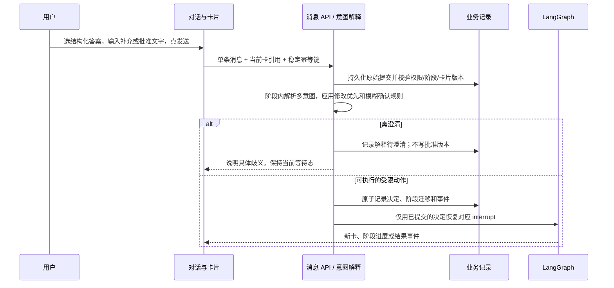

# MYATOM 结构化决策卡与底部单一发送入口：技术及交互设计讨论稿

> 状态：**历史讨论稿；用户于 2026-11-01 指定实施推荐方案 B**。正式决策见 [ADR-010](decisions/ADR-010-structured-card-single-send.md)，现行要求见 [PRD](PRD.md)、[架构](ARCHITECTURE.md)、[MVP1 UI](MVP1-UI.md) 与[单一发送 TC](../tests/cases/SINGLE-SEND.md)。下文的“现状”“待确认”“尚未执行”均为提出方案时的记录，不代表当前代码和文档状态。

## 1. 依据、现状与设计目标

本讨论依据 [PRD](PRD.md)、[架构](ARCHITECTURE.md)、[MVP1 UI](MVP1-UI.md)、[设计规范](DESIGN-STANDARD.md)、[V7 设计入口](../design/design.md)、[V7 交互说明](../design/INTERACTIONS.md)、[ADR-006](decisions/ADR-006-single-main-run-scope.md)、[ADR-008](decisions/ADR-008-manual-build-recovery.md) 及 2026-11-01 的当前代码。用户讨论确定的方向是：**卡片负责结构化呈现和采集，底部对话框负责补充说明及提交；用户只面对一个“发送”按钮，Agent 在内部判断本次消息是回答、调整、提问还是明确批准。** 这是本稿的设计输入，不表示现行基线已被改写。

| 层面 | 当前已存在的事实 | 本稿拟议的变化 |
| --- | --- | --- |
| 呈现 | `web/src/App.tsx` 将澄清、计划、构建失败卡放在对话时间线；已提交决定可回看。V7 视觉原型不是功能证据。 | 保持卡片结构化、时间线和只读历史；卡片不再提供提交确认/修复的独立按钮。 |
| 输入 | 底部已有持续输入区，澄清时发送补充需求、计划时发送修改意见、构建失败时发送定向修复意见；澄清确认、计划批准、继续修复与原样重建仍由卡内按钮发起。 | 底部同一输入区收集自由文本及当前卡的结构化选择；唯一提交入口始终为“发送”。 |
| 后端 | `POST /api/runs/{id}/decisions` 接受前端预选 `action`、`card_id`、`spec_version`；`backend/store.py` 校验阶段、卡片动作及版本，`backend/workflow.py` 在 `interrupt()` 后恢复。 | 提议单条消息提交契约；服务端先解析意图，再由确定性门禁转为现有受限决策动作。模型判断本身不能批准计划或调用写代码工具。 |
| 工作流 | 澄清 1–3 张卡，每张 1–3 题；计划修改留在 Plan；批准后才进入 Prepare；构建失败按 ADR-008 人工恢复。 | 保留这些阶段上限和硬门禁；改变等待节点消费用户输入的方式。暂不引入跨阶段自动回退、通用 sidecar 聊天或已完成 run 的自动续跑。 |
| 恢复 | 项目/决定/事件以服务端为准；前端按 `seq` 合并事件、SSE 加轮询，草稿在 `sessionStorage`。 | 增加消息、解释结果和待澄清状态的持久记录；保证重试、断线与多标签页下同一发送至多提交一次业务动作。 |

**目标**：让非开发者先读一张清楚的决策卡，必要时在卡上选答案，再用自然语言补充或确认，并通过同一个底部按钮提交。用户应能从对话中看见 Agent 如何理解本次发送、是否已执行、最新待决定事项是什么。计划批准前绝不写生成文件；对“可以”“好”等含糊表态，绝不靠模型猜测放行构建。

**范围边界**：本文设计的是“当前阶段内消息到受限动作”的解释层。项目创建仍需明确提交初始需求；完成、取消、预算耗尽等终态后的新版本迭代仍显式创建新 run。版本回滚、项目切换、预览、发布和管理员操作不由这条消息隐式触发。构建中可写下一轮草稿；本稿不把草稿发送变成对运行中 spec 的修改。取消任务可保留独立的安全控制，本文“单一按钮”指澄清、计划和构建失败等待态的**对话提交入口**，不废除导航、取消或查看证据等非对话控件。

## 2. 用户交互契约

### 2.1 一张当前卡、一个底部提交入口

1. Agent 在时间线中发出当前澄清卡、Build Plan 卡或构建失败处理卡。卡片展示已知事实、问题/选择、默认值和影响，或计划的页面、数据、限制、验收点，或失败证据和当前允许的恢复范围。**结构化选项仍在卡上可编辑**，但卡上不放“确认这些需求”“确认并开始生成”“继续修复一次”“重新构建”等提交按钮。卡内可有“定位输入区”、展开证据等非提交链接；重复的主动作不出现在右栏。
2. 底部输入区固定显示当前任务的短提示和“发送”按钮。提示仅解释当前输入会关联哪张卡，例如“回答卡片问题，可在这里补充说明；认可计划时请明确写出要按当前计划开始生成”。按钮文案不随意图变化，避免让用户先理解 `approve_plan`、`revise_plan` 等内部动作。
3. 澄清题目的选择及文本是同一次发送的快照。必答项必须有明确值；采用默认值也要用户明确选择，不能将“未答”当作同意。无自由文本但结构化答案齐全时允许发送；只有自由文本而缺必答项时，可作为补充/修改意图处理，但**不得视为已经确认澄清**。
4. 计划卡没有结构化答案时，发送文字可以是修改意见、问题或明确批准。空文字不批准计划。给出修改意见后 Agent 生成新版卡，旧卡锁定为只读；新版本必须再次明确批准。构建失败卡同理，通过文字表达“再修复一次”“按以下方向修复……”或“用现有代码重新构建”；不能把普通的“继续”猜作某个具有不同副作用的动作。
5. 提交后先显示用户原文/所选答案的摘要与“正在理解”；服务端返回解释结果后，再显示“已记录回答”“计划已更新，待确认”“已按当前计划开始生成”或“需要你说清楚”的明确反馈。历史卡只读，记录**用户实际提交**与**服务端最终执行**，不把候选模型意图写成既成事实。

同一项目内，切换右侧视图不卸载对话；切换项目时，草稿和卡片选择按 `project_id + run_id + card_id + spec_version` 隔离。卡片更新后旧草稿保留供比较，但不得直接提交到新卡。键盘可依次到达卡片选择、输入框、发送按钮；发送前后焦点可预测，错误和新状态用简短 `aria-live` 文案告知。宽屏目标继续沿用 1280×720、1366×768、1440×900 的桌面验收范围。

### 2.2 三个等待阶段的时序

| 阶段 | 用户所见与发送 | 服务端解释及门禁 | 下一步 |
| --- | --- | --- | --- |
| `WaitClarify` | 查看第 1–3 张澄清卡，选 1–3 题的答案/默认值，可在底部补充；按“发送”。 | 先固定本次卡片答案快照与原文；若是需求调整，调整优先，重发本阶段澄清卡，不能暗中确认旧答案。若是完整回答，校验题目后记录确认，再由 `ClarityGate` 判断缺口。 | 完整则进 Plan；仍缺关键约束且未达 3 卡则继续澄清；第 3 卡后仍缺则按现行规则结束本 run 并说明原因。 |
| `WaitPlan` | 阅读当前 `spec_version` 的计划；底部发送修改意见、问题或明确批准。 | 多意图中任何实质修改先走 `revise_plan`；提问先回答并保持等待；只有明确、无修改/未决问题的批准通过确定性门禁，才保存 `approved_spec_version`。 | 修改后产生新版计划并重新等待；批准后进入 Prepare；关键缺口或超范围按 ADR-006 结束当前 run，不自动跳回 Clarify。 |
| `Prepare` 至 `CommitVersion` | 对话显示真实阶段与进展；底部可保留下一轮草稿，但本轮不能用普通消息改已批准 spec。 | `Prepare` 再校验批准版本，写文件及构建受节点权限约束。中途取消走现有安全控制。 | 成功保存可用快照；失败按类别进入有限自动修复或 `WaitRepair`，旧可用版本继续可见。 |
| `WaitRepair` | 失败卡展示命令、最近错误、尝试次数和日志入口；底部用自然语言表达一种恢复请求并发送。 | 仅在当前卡允许的集合内映射为 `continue_repair`、`guided_repair`、`rebuild`。含糊的“继续”或同时要求改码与原样重建时先澄清；指定方向不得覆盖已批准需求及模板/存储边界。 | 每次只执行一次明确选择；再失败生成新的卡片版本；环境故障只允许明确的原样重新构建。 |



## 3. 单次“发送”的数据契约（拟议）

建议新增 `POST /api/runs/{run_id}/messages`，或在实现评审时选等价的 `submissions` 路由；**不复用当前要求客户端指定 `action` 的 `/decisions` 请求体作为自然语言入口**。一次点击产生一个稳定的 `submission_id` 和 `Idempotency-Key`。客户端不提交 `approve_plan` 等业务动作，也不提交自称可信的阶段；服务端从项目、run 与当前卡快照获取权威上下文。

```json
{
  "submission_id": "client-generated-uuid",
  "card_ref": { "card_id": "current-card-id", "spec_version": 4 },
  "text": "把首页改成只显示今天的任务，然后按新计划开始",
  "answers": {},
  "reply_to_interpretation_id": null
}
```

`answers` 是澄清卡问题 ID 到**用户所选实际值**的映射；选择建议默认值时也写入该值。`text` 为原文，可为空仅限澄清答案已满足提交条件；不能空白批准计划或触发修复。`reply_to_interpretation_id` 只用于回答本次消息的歧义追问，不得绕开当前卡版本校验。长度、题目 ID、枚举值、内容类型及权限由服务端校验；任何模型生成的 HTML、动作名称、工具调用或角色指令都只按用户数据处理。客户端草稿与已发送消息分开保存，不在浏览器存储服务端幂等账本。

建议响应包含 `submission_id`、`message_status`（`interpreting` / `needs_clarification` / `committed` / `rejected`）、`interpreted_intents`、`committed_action`（可为空）、`current_card_ref`、`run_status`、`latest_event_seq`；公开给普通用户的解释是短中文摘要，内部分类标签可仅供诊断。异步解释时返回 202 和消息状态，后续由事件更新；409 返回最新卡片引用及可读原因，客户端保留原文与选项。终端只显示已提交事实，不能把 `interpreting` 当作批准成功。

现有卡片 JSON 的 `type/schema_version/card_id/run_id/status/payload/actions` 可继续作为**服务端允许动作集合和渲染数据**。是否删除/替换 `actions` 字段属于后续协议评审；本方案不要求在未确认前修改旧卡协议。消息、解释结果、最终决定各有稳定 ID 与时间，事件仍按同 run 单调 `seq` 回放。

## 4. 阶段内多意图解析与保护规则

解释器输入为：当前服务端阶段、当前卡及版本、已批准事实、原始消息、结构化答案。输出为**候选意图集合**、对应原文证据片段、涉及的卡片字段、歧义/冲突标志和建议回复；不得输出任意 Graph 节点名、工具权限或“已批准”事实。候选意图只在当前阶段白名单内生效：澄清阶段为回答/补充/改原需求/提问；计划阶段为改计划/提问/批准；构建失败阶段为三种 ADR-008 恢复请求/提问。分类失败、超时或低把握度时留在等待态并请求用户说清楚，不能采取默认批准。

处理顺序如下，且每次只落地一个会改变工作流的动作：

1. **先查当前状态和卡片版本**。旧卡、未授权用户、终态 run、运行中普通消息或不在卡片允许集合内的动作直接拒绝或保留草稿；模型不能改变此结果。
2. **提取所有意图，不以第一个关键词定案**。例如“问题 1 选默认，但把登录去掉，然后开始做”同时含回答、修改和批准；“如果能本地保存，我同意计划”同时含条件与批准。
3. **修改优先于批准**。凡包含会改变需求、功能、页面、数据、验收或修复方向的具体修改，先提交当前阶段的修改；任何“顺便开始”“改完就做”只作为说明保留，不能批准旧 `spec_version`。新卡生成后再次等待用户明确确认。澄清阶段的修改使本次选择成为待核对资料，不自动确认旧卡。
4. **未解决的问题/条件先于批准**。若“能否……”“如果……才同意”会影响范围、代价或验收，先回答或追问，当前计划保持待批准。明确无关的闲聊不应偷偷推动阶段；在 ADR-006 范围内不能把它扩展为 sidecar 会话。
5. **批准须满足明确证据**。计划批准只在用户明确指向当前计划并要求开始生成（如“按这版计划开始生成”）且没有修改、条件或未回答问题时可提交。单独的“好”“可以”“确认”“继续”“没问题”、仅填写答案、沉默或空文本都不是计划批准。解释器可识别等义表述，但确定性门禁必须检查当前卡引用、计划版本、无冲突意图和显式批准证据；若证据无法可靠判定，发出针对性追问，等用户对当前计划明确表态。澄清卡的“确认”同样不能代替必答题目的明确选择。
6. **构建恢复请求不得混合执行**。“再修一下并重新构建”可解释为一次受限修复后构建；“别改代码，直接重建”是原样重建；同时要求互斥操作或只说“继续”时先列出当前可行的自然语言说法并等待回复。预算、错误类型、卡片 `actions` 仍由服务端裁决。

| 输入示例（当前卡） | 解释结果 | 是否推进 |
| --- | --- | --- |
| 澄清卡：已选全部必答项，文本为空 | 完整回答；显式默认值按所选记录 | 校验后进入 `ClarityGate` |
| 澄清卡：“问题 2 选默认，但不要用户登录” | 回答 + 改需求，修改优先 | 重发澄清，不能沿用旧卡确认 |
| 计划卡：“首页少一个统计栏，改完就开始” | 改计划 + 批准候选 | 只生成新版计划，不构建 |
| 计划卡：“按这版计划开始生成” | 明确批准当前计划 | 门禁通过后保存 `approved_spec_version` |
| 计划卡：“可以”或“确认” | 指向和后果不够明确 | 追问；无写文件 |
| 计划卡：“如果能跨设备同步，我同意” | 条件/范围问题 + 批准候选 | 说明当前范围不支持；不批准；按现有规则处理范围冲突 |
| 失败卡：“用现在的代码重新构建，不要修改文件” | 明确原样构建 | 仅 `rebuild`，且卡允许时执行一次 |
| 失败卡：“继续” | 恢复方式不明 | 追问；不执行修复或构建 |

## 5. LangGraph 门禁与状态迁移（拟议）

解析层放在 API/业务命令边界，或封装成只产生候选解释的纯节点；无论放在哪里，**最终动作由服务端确定性校验后才恢复等待节点**。保留 `thread_id = run_id`、现有 `WaitClarify`/`WaitPlan`/`WaitRepair` 的 `interrupt()` 与 checkpoint。不得让自然语言解析直接指定 `Prepare`、`CodeLoop`、`BuildTest`，或替代 `Prepare` 对 `approved_spec_version` 的再次检查。

| 当前状态 | 有效提交及门禁后的业务动作 | 目标状态 | 不允许的迁移 |
| --- | --- | --- | --- |
| `awaiting_clarification` | 完整答案 → `confirm_clarification`；需求调整 → `revise_clarification` | `clarifying`，再经 `ClarityGate` | 未答必答题直达 Plan；第 3 卡后无上限补问 |
| `awaiting_plan` | 实质修改 → `revise_plan`；明确批准当前版 → `approve_plan` | `planning` 或 `building/Prepare` | 问题/含糊确认 → Prepare；新版计划沿用旧批准；自动回 Clarify |
| `clarifying/planning/building` | 常规消息暂不改变本 run；取消沿既有命令 | 原状态或取消流程 | 运行中改已批准 spec、隐式新建 run |
| `awaiting_repair` | 当前卡允许且明确的 `continue_repair` / `guided_repair` / `rebuild` | `building/CodeLoop` 或 `building/BuildTest` | 环境故障改码；同一发送执行两种恢复；预算用尽后继续 |
| `completed/failed/cancelled/budget_exceeded` | 显式新 run 命令（若允许） | 新 `run_id` | 在旧 Graph 上自动续跑或以消息执行版本回滚 |

`approve_plan` 的业务事务必须同时记录原始提交的引用、最终决定、`approved_spec_version`、阶段变化和 `decision_submitted` 事件；提交后再调度 Graph。`WaitPlan` 只消费已提交决定，不能消费未经验证的模型候选；`Prepare` 在每次执行及重入时再次比较批准版本。计划修改事务不得设置批准版本，且须生成新 `card_id/spec_version`。构建工具权限仍按现行架构划分，解析器没有写文件、执行命令或发布权限。

## 6. 持久化、幂等、断线与并发边界

- **权威来源**：服务端保存原始用户消息、结构化答案快照、解释版本/结果、最终决定、卡片和事件；浏览器仅存未发送草稿及 UI 偏好。消息与解释结果可重读，以避免刷新后出现“用户发送了但系统不知是否执行”的空白。解释器模型/提示词版本和简短证据引用供诊断；不把密钥、完整内部提示词或生成应用私有业务数据放进活动流。
- **幂等键**：同一 `submission_id`/`Idempotency-Key` 加同一请求摘要，重复提交返回同一消息与最终决定；**同键不同正文或答案必须 409**。网络超时后客户端原键重试并先查询状态，不生成第二个批准或修复请求。当前 `/decisions` 已对 `(run_id, idempotency_key)` 唯一约束并去重，但还没有消息级解释记录，且已有重复键分支未比较请求摘要；这些都是实施差距。
- **原子提交与恢复**：解释可异步运行，但持久化的消息先于“已收到”回执。最终决定、状态迁移与事件同一业务事务；Graph 恢复使用持久队列或可重放的待处理决定。节点重入或服务重启应重放未处理决定，不重写文件、不重复构建或保存第二个版本；沿用现有操作账本、checkpoint 和版本幂等边界，额外验证消息与 checkpoint 的一致性。
- **多标签页/并发**：同项目仅一个活动 run。多个标签同时提交同一卡片时以服务端事务和 `(run_id, card_id, spec_version)` 乐观锁串行化；首个有效决定使卡失效，其他提交收到 409 和最新卡。解释器在模型调用前后都重新读取版本；过期解释结果只留作记录，绝不执行。不同幂等键的两个同时批准也只能产生一个 `approved_spec_version` 和一次 Prepare。
- **断线**：发送后连接断开显示“状态待核对”，保留原文、选择和键；重连先读取项目/当前卡与该 `submission_id` 的处理结果，再按 `after_seq` 补事件，按 `seq` 去重。不能因为 SSE 重连、页面刷新或右侧切页重发新 run。409 时展示新卡与旧草稿对比，要求用户重新核对，不自动把旧批准映射到新版本。
- **预算与错误**：等待用户澄清或回答歧义不累计 Agent 执行时间；解释调用和 Graph 执行须计入相应服务预算并可观察。分类模型失败、格式无效或服务超时都保持等待态，可用同键安全重试或给出可恢复错误；不得默认批准。构建失败人工恢复仍沿用原 run 的模型调用、修复次数和累计执行时间边界。

## 7. 验收用例（实施时转为设计、前端、后端及端到端 TC）

每例记录步骤、输入、预期、实际、环境、代码版本和事件/截图证据；下面是**设计验收条件，尚未执行**。

| ID | 场景 | 必须观察到 |
| --- | --- | --- |
| SD-01 | 澄清卡选齐必答及默认值，文本留空发送 | 仅一个底部发送按钮；答案入库，历史可读；`ClarityGate` 决定下一步。 |
| SD-02 | 澄清卡漏必答项，或补充内容修改了需求 | 前者不确认；后者修改优先，旧卡不被隐式确认，最多 3 卡上限仍生效。 |
| SD-03 | 计划卡发送“把 X 改成 Y，然后开始” | 只产生新版计划；`approved_spec_version` 为空或保持旧 run 的既有事实；无 Prepare/文件写入。 |
| SD-04 | 当前计划卡发送“可以”“确认”“继续”及空消息 | 无批准、无构建；提示明确写出按当前计划开始生成的意思。 |
| SD-05 | 当前计划卡明确发送“按这版计划开始生成” | 恰好一次批准；批准版本与卡版本一致；随后才允许 Prepare。 |
| SD-06 | 修改计划后用旧卡/旧版本再发明确批准 | 409；展示新卡和旧草稿；无构建。 |
| SD-07 | 计划消息含条件、问题和批准，或提出超出模板的跨设备同步 | 先回答/说明边界；不构建、不自动回 Clarify；按 ADR-006 处理范围冲突。 |
| SD-08 | 构建失败分别请求继续修一次、指定方向、原样重建及只说“继续” | 前三项仅在允许时各执行一次；含糊请求不执行；环境故障不能改码。 |
| SD-09 | 同键重发、同键不同正文、两标签不同键抢同一卡 | 分别返回同一结果、409、恰好一个有效决定；仅一次 Graph 恢复和外部副作用。 |
| SD-10 | 发送后断网/刷新/服务重启，再恢复 | 可查原消息、最终解释和卡状态；事件无重复；草稿不混项目/卡版本。 |
| SD-11 | 构建中输入下一轮需求、切换右栏/项目，再回来 | 当前 run 和已批准 spec 不变；草稿按项目隔离；无隐式新 run。 |
| SD-12 | 键盘完成澄清、计划修改与明确批准；在三个桌面目标视口检查 | 当前卡和底部发送可达，焦点清楚；状态有文字，错误可读，历史卡只读。 |

## 8. 与已确认设计的冲突、选项和实施顺序

| 冲突来源 | 现行条款 | 本稿拟议变化及影响 |
| --- | --- | --- |
| [PRD §4](PRD.md#4-界面与结构化呈现)、[MVP1 UI §4.1–4.2](MVP1-UI.md#4-核心卡片与动作)、[V7 Harness §3](../design/harness.md#3-交互护栏) | 澄清/计划的主确认动作在卡片内，底部输入按阶段确定语义；卡片为唯一权威操作位。 | 权威操作位移到底部单一发送；卡片只提供结构化选择/说明。必须同步修改界面描述、设计回归和焦点/可达性用例。 |
| [PRD §2/§4](PRD.md)、[架构 §1/§3/§5](ARCHITECTURE.md)、[ADR-006](decisions/ADR-006-single-main-run-scope.md) | 明确不做消息意图分类；客户端提交已选 `action`，计划修改只在同阶段。 | 增加**阶段内**多意图解释及消息契约。即使维持单 run、无跨阶段回退，仍与“不识别消息意图”冲突；API、状态、事件、模型预算、回归 TC 均受影响。 |
| [MVP1 UI §4.3–4.4](MVP1-UI.md)、[ADR-008](decisions/ADR-008-manual-build-recovery.md) | 构建失败卡内有继续修复/原样重建按钮，底部只写指定方向。 | 若统一等待态提交，三个恢复请求都经自然语言解释；仍必须保持 ADR-008 的错误类别、一次动作和预算限制。 |
| [设计规范 §2.1](DESIGN-STANDARD.md#21-各阶段的屏幕主角)、[设计入口](../design/design.md) | 当前卡与一个主动作需显眼；V7 原型及现行前端的按钮位置与本稿不同。 | 需要重做原型与正式 UI 的动作位置；原型确认不能当成该变化已实现。 |

**历史方案选择记录**：A. 保持原卡内按钮和前端显式 `action`；B. 结构化卡 + 底部单一发送 + 阶段内意图解释 + 确定性门禁；C. 跨阶段回退与全局路由。用户随后明确指定按本稿修改，故 B 已采纳并形成 [ADR-010](decisions/ADR-010-structured-card-single-send.md)；C 仍不在当前范围。

若确认 B，按以下顺序推进，并在每步完成后记录实际测试结果：

1. 按 ADR-002 更新 PRD、架构、MVP1 UI、V7 设计入口/Harness 与相关 ADR/TC，明确哪些旧条款被替代；保留旧决策记录。先定语义边界与模糊确认文案，再冻结消息/事件 schema。
2. 增加服务端消息与解释记录、请求摘要幂等、卡片版本乐观锁、阶段白名单和明确批准门禁；以受限决定适配现有 `interrupt()`，保持 `Prepare` 二次校验。为断线、并发、重入和多意图优先级建立后端及端到端测试。
3. 将卡片内提交按钮收敛为底部唯一“发送”；保留卡上结构化答案、只读历史、失败证据和非提交导航。实现解释中/需澄清/已提交/冲突状态，键盘、焦点、草稿隔离及 SSE/轮询恢复。
4. 用 SD-01～SD-12 走完桌面与故障注入；核对真实事件、批准版本、文件副作用和可用快照。先在本地真实服务验证，再按既有 MVP/公开环境验收边界复测；不得用 V7 模拟状态或静态截图代替功能通过。
