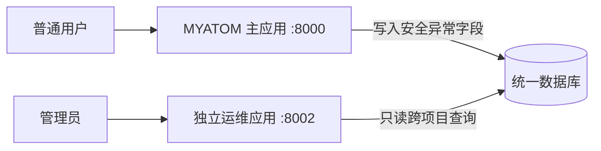

# 异常收集与独立管理员后台设计（v2）

状态：2026-10-31 实施契约。用户要求**跨所有项目的管理员异常后台，独立部署，不使用当前主应用，仅通过统一数据库读取和展示数据**。产品基线见 [PRD](PRD.md)，主系统见 [架构](ARCHITECTURE.md)，变更规则见 [ADR-002](decisions/ADR-002-change-control.md)，本次边界见 [ADR-003](decisions/ADR-003-exception-console.md)。

## 1. 两个部署单元

- **主应用**保留现有工作台、Agent、项目 API 与六个页面。服务端在终态异常时向统一数据库写入结构化记录。主应用不挂载 `/ops` 页面或 `/api/ops` 接口，不接收或校验管理员密钥。
- **运维应用**是独立 Python API + React/TS/Vite 页面，独立启动、构建和部署。只读取统一数据库中的异常、run 事件及非敏感关联字段；不调用主应用 HTTP API，也不复用访客 cookie。它不修改业务表或异常记录。
- 本地使用同一主机上的 SQLite 文件 `data/myatom.sqlite3`，主应用读写、运维应用以 SQLite `mode=ro` 打开。WAL 支持本地两个进程的并发读写。**不同机器的独立部署不能靠复制 SQLite 文件达成统一数据库**；上线前须验证共享数据库服务或可靠共享卷，并让两端通过可替换仓储接口指向同一数据源。数据库选型与 Atoms 兼容性仍未验证。
- 运维应用独立 origin，默认本地 `http://127.0.0.1:8002`。不纳入普通产品导航，也不依赖主应用反向代理。

## 2. 采集契约

统一数据库包含 `exception_records` 与 `build_check_attempts`。一次真实终态失败、一次预算暂停或一次未处理 API 500 写一条；每次失败构建额外写一条 `build_check_failed` 警示与专用打点，通过的构建只写打点。采集失败不改变原 run/API 结果。预算和构建检查警示允许同 run 多条；其他终态错误仍按 run 去重。见 [ADR-016](decisions/ADR-016-build-check-observability-and-recovery.md)。记录只含白名单结构化字段：

| 字段 | 类型与含义 |
| --- | --- |
| `id` | UUID，异常记录 ID |
| `trace_id` | Agent/构建沿用 `runs.trace_id`；独立 API 500 新建 UUID 并在响应 `X-Trace-ID` 中返回 |
| `project_id` / `run_id` | 可空；Agent/构建必须关联；API 500 仅在可安全确定时关联 |
| `source` | `agent` / `build` / `api` |
| `phase` | 已知 Agent Node 名或受控 API 阶段；不存 URL/query |
| `code` | 稳定枚举，如 `model_output_invalid`、`model_call_failed`、`plan_validation_failed`、`unsafe_source`、`build_failed`、`build_no_progress`、`build_recurring_error`、`build_repair_limit`、`budget_exceeded`、`api_unhandled`；三个 `build_*` 停机码对应 [ADR-009](decisions/ADR-009-build-repair-harness.md) 的自动停机条件 |
| `exception_type` | 类名或受控类型名，不含异常消息 |
| `reason` | 错误码映射出的简短安全中文说明；预算错误可由受控触发项和数值生成具体原因；计划校验失败按固定子原因码显示缺失项或边界冲突，最多 300 字 |
| `severity` | 终态为 `error`，中间失败构建为 `warning` |
| `occurred_at` | UTC ISO-8601；与 ID 组成稳定倒序游标 |

主应用在 `Workflow._process` 预算暂停、未预期异常终态、最终构建失败，以及 FastAPI 未处理 500 处采集；`BuildTest` 的每次检查另记轮次、成败、类别、命令、退出码、耗时、修复轮次、当时用量、错误指纹、目标文件、TS 错误码和停机码。主动取消、普通 4xx、计划退回不写异常。对 `ModelOutputError` 因果链分类，模型输出结构失败的项目事件只写固定原因码，不保存模型原文。构建警示只存受控原因，具体构建日志仍受项目权限控制。API 给普通用户返回通用 500 文案与 Trace ID。写库失败写最小服务端告警，不触发递归异常。

`Plan` 的模型输出经确定性校验并自动修正后仍失败时，主 run 的结果卡标记 `failure_stage=plan`、固定子原因码和对应安全文案；独立后台的 `plan_validation_failed` 记录使用同一文案。页面不把这类错误描述为构建失败，也不展示不存在的构建命令。子原因码仅由服务端白名单生成，未知值降级为通用原因；不得把模型计划、原始异常文本或需求正文写入异常记录。

`ValidateSource` 的源码边界校验失败与构建失败分开：每个候选在项目事件中留下受控原因码、简短校验反馈与允许生成的目标文件；源码和构建共用自动修复停机规则，见 [ADR-013](decisions/ADR-013-source-validation-targeted-repair.md)。独立管理员异常后台读取源码校验停机记录和构建检查专用安全列，不展示候选源码或项目事件中的反馈文本。源码校验停机时记录一条 `unsafe_source`，原因由固定文案组合，并明确“本轮候选未进入构建”。历史 `agent_unhandled` 记录不自动改写。

**禁止持久化或返回**原始异常消息、堆栈、完整 prompt、模型响应、生成源码、请求正文/头、cookie、预览票据、应用业务数据、owner hash。现有 `runs.error` 与事件 payload 可能包含历史内容，运维后台仅查询事件的 `type/at/seq`，并从关联 `runs` 中只读取创建时间、累计 Agent 执行秒数、模型调用数及 Token 用量；不读取或渲染 payload、需求文本或运行错误。另以异常发生时间与 run 创建时间计算任务**存续时间**，它包含等待用户确认，不参与新时长预算。历史 run 的执行秒数为未知，不用存续时间反推，也不反写旧异常的触发项或阈值。计时语义见 [ADR-007](decisions/ADR-007-active-execution-budget.md)。

## 3. 独立运维服务与权限

运维服务从自身环境读取 `OPS_DB_PATH`（统一数据库绝对路径）与 `OPS_ADMIN_KEY`（高熵随机值）；主应用无需 `OPS_ADMIN_KEY`。所有 `/api/ops/*` 请求使用 `X-Operations-Key`，服务端常量时间比较。未配置密钥返回 503，错误/缺失返回 401，两种情况都不返回记录或总数。所有后台响应 `Cache-Control: no-store`。数据库连接使用只读模式，服务只运行在独立端口/进程，静态资源从独立 `ops-web/dist` 提供。

密钥只在当前运维页面 React 内存中使用；不进入 bundle、URL、localStorage、sessionStorage、cookie、日志或截图。刷新后重新输入。Trace ID 是关联标识，不是访问凭证。本地 Demo 的环境密钥不等同正式管理员身份；公开部署前需验证 HTTPS、正式身份服务或密钥轮换、限流与访问审计。不要把独立服务直接以无保护的公网端口暴露。

| 方法与路径（仅运维服务） | 输入 | 输出/错误 |
| --- | --- | --- |
| `GET /api/ops/exceptions` | `limit` 默认 30，范围 1–100；可选 `cursor`、`source`、`code`、`project_id`、`trace_id` | `{items, next_cursor}`，按时间/ID 倒序；非法参数 422；未配置 503；无权 401 |
| `GET /api/ops/exceptions/{id}` | UUID 记录 ID | `{exception, timeline, run_metrics, build_checks}`；`run_metrics` 仅含创建时间、执行秒数（历史可空）、存续秒数、模型调用数、Token 用量；`build_checks` 最多 60 条，只含专用安全列，历史缺失值为 `null` 或空列表；时间线最多 30 条，只含 `type/at/seq`；不存在 404 |

游标编码 `(occurred_at,id)`，筛选变化时前端清空游标。列表与详情都需验证密钥；知道 ID 不绕过授权。限定查询行数，不提供全表导出。异常表和相关索引由主应用迁移创建；运维服务在缺表时给出明确服务不可用状态，不自行迁移或写库。

## 4. 独立页面

运维页采用 V3 暖白、纸白、墨绿和语义危险色，但独立代码和构建产物。未验证时只显示密钥表单，无记录数。验证后显示最新读取时间、项目/来源/错误码/Trace ID 筛选、倒序列表、下一页及详情。列表展示发生时间、来源、阶段、安全原因、项目/run/trace 短 ID。详情展示完整 Trace ID（复制与 `aria-live` 反馈）、异常 ID、错误码/类型、阶段、原因、关联 ID、受控运行指标和最多 30 条事件类型时间线。历史泛化预算记录注明无法直接还原具体触发项与阈值；新记录直接展示受控数值原因。无关联显示“无关联”，不补造处理状态。

加载、空库、筛选无结果、401、503、读取失败各有不同反馈；失败不能显示为“0 条”。键盘可操作筛选、列表、详情与复制，打开详情后焦点移到标题。后台不渲染原始 HTML/堆栈。运维页没有主应用“返回工作台”依赖，也不复用主应用会话。

## 5. 前后端交付与 TC

**主服务端层**：只新增表/索引、安全写入、错误分类与采集；不提供跨项目查询。**独立运维服务端层**：只读数据库适配、管理员认证、分页列表/详情、单独静态资源与启动入口。**独立前端层**：单独 React/TS/Vite 工程、内存密钥、筛选/列表/详情/复制及各状态。配置示例与本地启动说明分别提供；实际密钥不提交。

**TC**：故障模型、最终构建失败、受控 API 500 产生真实记录且 Trace ID 对齐；两项目跨项目列表；访客凭证不能授权运维 API；错误/缺失/未配置密钥不泄露数据；敏感标记不进入异常表、API 或页面；SQLite 只读连接无法写业务表；分页稳定；独立 8002 进程不依赖 8000 服务即可查询已有记录；刷新后重新验证密钥；空、错误、筛选无结果及复制反馈可见。使用固定假模型和隔离数据库，不增加付费模型调用。过程证据另存 `D:\AI\ATOM笔试\docs`。
