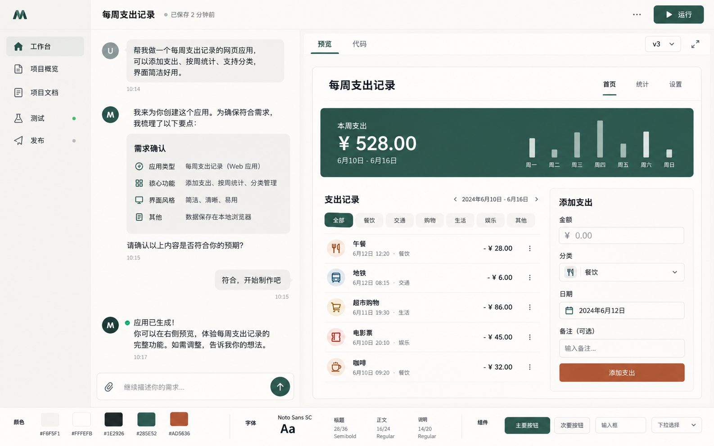
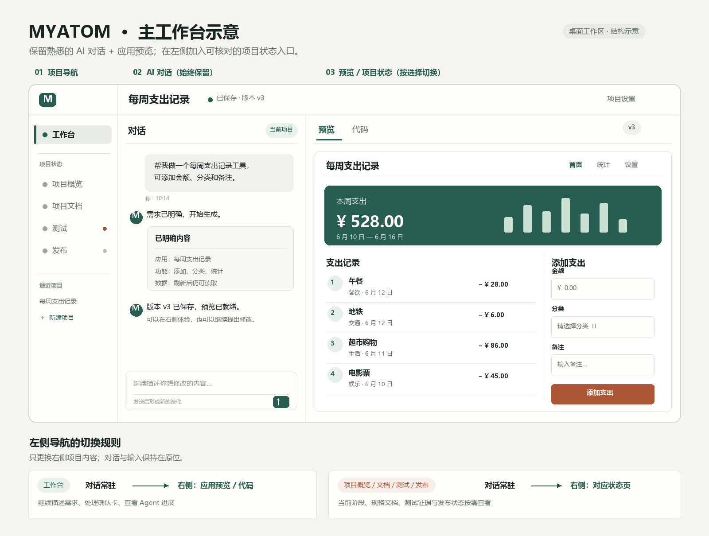

# MYATOM 主工作台视觉方向 v2

状态：2026-10-31 用户确认的布局方向；供后续实现评审。仅交付设计图，不表示当前产品已经实现图中的交互预览或发布能力。

## 决定与参考

保留常见的 **AI 对话 + 应用预览** 阅读顺序和交互，不把澄清、计划做成独占全屏的问卷。增加一条窄项目导航：**工作台、项目概览、项目文档、测试、发布**。选择左侧项目状态页时，只切换右侧内容；中间的对话、输入草稿与阅读位置持续保留。

这来自用户对首版“整页澄清表单”的修正，也参考了当前 [Atoms 的工作过程](https://help.atoms.dev/en/articles/12129548-working-with-agents)与 [App Viewer](https://help.atoms.dev/en/articles/12129554-app-viewer)：把沟通、决策、成果放在同一工作环境中。图片是 MYATOM 的独立设计，不复制 Atoms 品牌或页面。

## 桌面结构

以 1440×900 为设计基准，1280×720、1366×768 需单独检查。顶部项目栏建议 64–70px；左侧项目导航约 192–216px。**预览就绪后**，中间对话约 400–440px，其余给右侧预览，预览可用宽度尽量不低于 620px；**MVP1 等待澄清或计划、尚无预览时**，沿用更宽的对话/决策区，右侧仅放真实结果摘要或空状态。两侧内容可以各自滚动，输入框留在对话底部。窄桌面优先减少边距和收起次要文字，不把导航扩成第三个大面板。

| 左侧入口 | 中间固定区域 | 右侧默认内容 |
| --- | --- | --- |
| 工作台 | 对话、Agent 进展、澄清/计划卡、输入 | 当前版本的交互预览；预览尚未就绪时为真实版本/结果状态 |
| 项目概览 | 保持原对话与草稿 | 项目目标、当前阶段、最近成功版本与下一步 |
| 项目文档 | 保持原对话与草稿 | 需求、已确认计划、历史决定和生成文件入口 |
| 测试 | 保持原对话与草稿 | 已执行、失败、未执行的检查及证据入口 |
| 发布 | 保持原对话与草稿 | 发布条件、当前状态、真实链接或阻塞原因 |

左侧的“项目状态”是导航，不在一个页面中把四类内容平铺成等权卡片。状态徽标只由服务端事实驱动；未执行的测试不得标为通过，未发布的项目不得显示“已上线”。

## 交互细则

1. 澄清和计划作为对话时间线中的紧凑决策卡展开。当前卡片可充分阅读和编辑，已处理卡片折叠成摘要；保留原有确认门禁、版本校验和恢复规则。
2. 切换左侧入口时，右侧更换视图，中间对话不卸载；输入草稿、滚动位置和未提交的表单选择保留。返回“工作台”时恢复先前选中的版本与“预览/代码”页签。
3. 工作台右侧默认优先显示可交互预览。MVP1 没有有效 `preview_ref` 时，展示已保存版本、测试摘要或“预览尚未就绪”，不能用设计图中的模拟应用冒充运行中的应用。
4. 右侧长文档、日志、测试证据按需展开；主视线只保留当前任务和可验证的最新结果。对话输入和重要确认动作不被右侧滚动带走。
5. 键盘可依次访问导航、对话、右侧内容；切换后将焦点放在对应页面标题，返回时还原到触发入口。状态通过文字表达，焦点可见。

## 视觉定调

“编辑台”继续使用暖中性底色、墨绿正文与完成态、陶土橙主动作。左侧导航用比内容区略深的浅色后退，中间对话保持轻量，右侧预览获得最多可用面积。正文 15–16px，辅助信息 13–14px；边框只用于区分分区，不使用大面积暗色侧栏、渐变 AI 装饰或等宽卡片矩阵。颜色以 [设计标准](DESIGN-STANDARD.md#5-视觉系统)中的语义 token 为实施依据，图像为气质与布局参考。

MYATOM 建造工作台只按桌面浏览器设计。用户生成的应用是否适配手机，由该应用自身需求决定，不在本次工作台设计范围内。

## 图示边界

两张图中的“每周支出记录”、版本 v3、测试提示和支出记录均为排版示例，不代表当前项目已经生成、测试或发布。风格图表达材质与气质；主工作台示意图表达分区比例、导航名称和切换规则。首版[澄清态风格图](../design-prototype/visual-direction-v1.png)与[可点击探索原型](../design-prototype/index.html)保留为过程记录，不作为本版主工作台实现依据。
